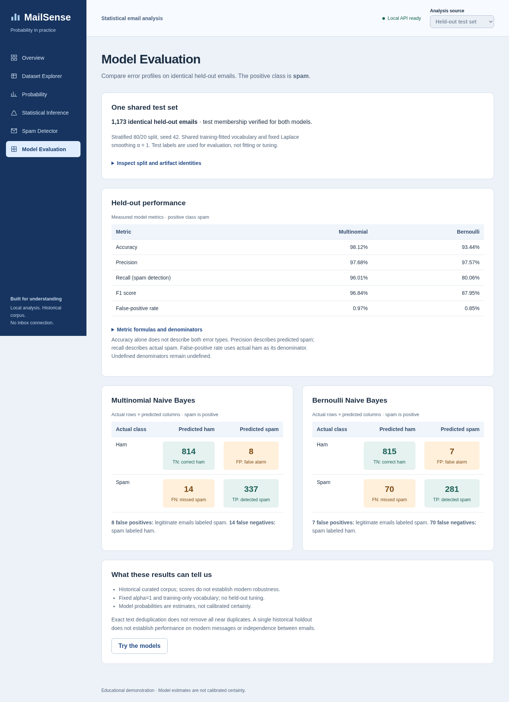

# MailSense

**Version 1.0.0** · **Statistical Analysis and Probabilistic Email Spam Detection**

**Status:** **39/39 core tasks complete · v1.0.0**. The [conference paper](docs/PAPER.md), [30-slide PowerPoint and complete 58-page platform guide](docs/LEARNING_KIT.md) are delivered. Obsolete document-production scripts have been removed. All 43 assigned tickets are complete. See the [handoff](memory/HANDOFF.md).

Explore a historical email corpus, verify probabilities and statistical tests,
and compare Multinomial and Bernoulli Naive Bayes in one local workspace.
Counts, denominators, assumptions and errors accompany the results.

- **Dataset Explorer:** provenance, exclusions, class balance, summaries,
  histograms, five-number plots and document frequencies.
- **Probability:** contingency counts, Bayes' theorem, Bernoulli and binomial
  demonstrations with explicit all/train/test scope.
- **Statistical Inference:** Pearson chi-square and Wilson confidence intervals.
- **Spam Detector:** transient subject/body input, both frozen models,
  disagreement and faithful log-odds explanations.
- **Model Evaluation:** identical held-out IDs, five metrics and labeled
  confusion matrices.



## Install and prepare

Verified baseline: **Linux x86_64**, Git, a Python 3.12+ bootstrap interpreter,
**uv 0.13.9** and initial internet access. The helper installs checksum-verified
**Node 22.23.5/npm 10.9.9** locally; uv installs **Python 3.12.15** and frozen
backend dependencies. No working system Node is required.

```bash
git clone https://github.com/hixam001/mail-sense.git
cd mail-sense
python3 scripts/node.py install
python3 scripts/node.py npm --prefix frontend ci
uv sync --project backend --frozen
```

From the repository root, prepare the private corpus and models in this order:

```bash
uv run --directory backend --frozen python -m scripts.download_corpus download
uv run --directory backend --frozen python -m scripts.ingest_corpus run
uv run --directory backend --frozen python -m scripts.prepare_dataset run
uv run --directory backend --frozen python -m scripts.split_dataset run
uv run --directory backend --frozen python -m scripts.verify_statistics run
uv run --directory backend --frozen python -m scripts.train_models run
uv run --directory backend --frozen python -m scripts.evaluate_models run
uv run --directory backend --frozen python -m scripts.verify_science run
```

A clone contains shareable manifests and aggregate reports, **not original mail
or trained models**. Installation alone therefore reports degraded readiness.
Preparation downloads five pinned official archives and regenerates the local
artifacts. Subsequent analytical use works offline. New acquisition/training
UTC timestamps and provenance-dependent report hashes may differ; scientific
counts, split membership, vocabulary and predictions reproduce with these pins.
See [setup and recovery](docs/SETUP.md) for verification commands and platform limits.

## Run

In one terminal, from the repository root:

```bash
uv run --directory backend --frozen python -m scripts.serve
```

In another:

```bash
python3 scripts/node.py npm --prefix frontend run dev
```

Open **http://localhost:5173/**. The overview should show ready dataset, both
models and held-out evaluation. The backend binds to **127.0.0.1:8000**;
[health](http://127.0.0.1:8000/api/v1/health) and
[OpenAPI JSON](http://127.0.0.1:8000/openapi.json) are local endpoints.

For a production UI build, stop the development UI, then run:

```bash
python3 scripts/node.py npm --prefix frontend run build
python3 scripts/node.py npm --prefix frontend run preview
```

Development and preview share loopback port 5173; run one at a time. The API
remains required. Follow the [eight-step classroom demo](docs/DEMO.md).

## Verify

```bash
python3 scripts/node.py npm --prefix frontend run lint
python3 scripts/node.py npm --prefix frontend test
python3 scripts/node.py npm --prefix frontend run build
uv run --project backend --frozen ruff check --config backend/pyproject.toml backend/app backend/tests backend/scripts scripts
uv run --project backend --frozen pytest -c backend/pyproject.toml backend/tests scripts/tests
```

For production browser acceptance, install the optional test browser once:

```bash
python3 scripts/node.py node frontend/node_modules/playwright-core/cli.js install chromium
python3 scripts/browser_check.py --production
python3 scripts/release_check.py
python3 scripts/smoke_check.py
python3 scripts/offline_check.py
```

`offline_check.py` additionally needs Linux namespace support and iproute2; it
leaves the workstation network unchanged. These runners start and stop their own missing local servers. Stop existing
app servers before release/failure/offline checks to keep the test environment
unambiguous. A trusted existing Chromium can be selected with
`--browser /absolute/path/to/chromium`. Initial browser installation needs
network access. [UI coverage](docs/UI_VERIFICATION.md),
[runtime method](docs/RUNTIME_VERIFICATION.md) and the
[test plan](docs/TEST_PLAN.md) describe the observed scope and limitations.

## Measured experiment

Five canonical Apache SpamAssassin archives yielded **5,862 retained emails**:
4,107 ham and 1,755 spam. Parsing excluded 54 malformed-MIME candidates;
deduplication excluded 130 same-label duplicates. A seed-42 stratified 80/20 split
contains **4,689 train / 1,173 test** records. Both models use the same 60,135
training-only features, test IDs and α=1 smoothing.

| Model | TN | FP | FN | TP | Accuracy | Spam recall |
|---|---:|---:|---:|---:|---:|---:|
| Multinomial | 814 | 8 | 14 | 337 | 98.12% | 96.01% |
| Bernoulli | 815 | 7 | 70 | 281 | 93.44% | 80.06% |

These are measured results on one historical holdout. They do not establish
modern robustness, population prevalence or calibrated probabilities. Exact
values and identities are in the [model card](docs/MODEL_CARD.md) and
[evaluation JSON](artifacts/reports/evaluation.json). The
[university report](docs/UNIVERSITY_REPORT.md) includes formulas, inspected
screenshots, runtime measurements, an authored failure example and limitations.

## Documentation and project memory

| Document | Purpose |
|---|---|
| [Release and known limits](docs/RELEASE.md) | v1.0.0 checklist, evidence and supported scope |
| [Setup](docs/SETUP.md) | Full preparation, locks, verification and recovery |
| [Demo](docs/DEMO.md) | Eight-step classroom walkthrough and evidence mapping |
| [Presentation and handbook](docs/LEARNING_KIT.md) | Project PowerPoint, presenter notes and full platform guide |
| [Conference paper: PDF and DOCX](docs/PAPER.md) | Eight-page paper with new paired analysis and editable author fields |
| [University report](docs/UNIVERSITY_REPORT.md) | Academic methods, figures, results and limitations |
| [Reproducibility](docs/REPRODUCIBILITY.md) | Independent arithmetic, hashes, split and reference refits |
| [Model card](docs/MODEL_CARD.md) | Model identities, results and explanation semantics |
| [SRS](docs/SRS.md), [PRD](docs/PRD.md), [SRD](docs/SRD.md) | Locked scope and requirements |
| [Architecture](docs/ARCHITECTURE.md), [API](docs/API_CONTRACT.md), [data model](docs/DATA_MODEL.md) | Implementation boundaries and contracts |
| [Statistical methods](docs/STATISTICAL_METHODS.md), [app flow](docs/APP_FLOW.md) | Formulas and user journeys |
| [Test plan](docs/TEST_PLAN.md), [implementation plan](docs/IMPLEMENTATION_PLAN.md) | Acceptance, core tasks, academic deliverables and maintenance |
| [Design system](DESIGN.md), [UI verification](docs/UI_VERIFICATION.md) | Interface conventions and browser checks |
| [Handoff](memory/HANDOFF.md), [memory guide](memory/README.md) | Current progress, next task and Graphify retrieval |

For development, read [AGENTS.md](AGENTS.md) and the handoff first. The workflow
is Gravitas analysis → implementation → verification → handoff/graph update →
Jira-style commit → push. Agent installations under `.agent/`, `.agents/`,
`.codex/`, `.gravitas/` and `.impeccable/` remain local and ignored. No agent skill
or Graphify installation is required to run MailSense.

## Local data and scope

Pasted text is processed on this computer and is discarded when cleared or when
leaving the detector; it is absent from persistent history, URLs and normal
server logs. HTML, attachments and message-linked resources are never executed
or fetched. Files remain local; normal use does not train models.

This educational application has no accounts, live mailbox connection, mail
sending, quarantine, external inference or hosted deployment. Only trusted
project-created joblib files are supported. Keep raw mail, processed text,
models, credentials, runtime environments and agent files ignored; share only
source, lockfiles, manifests and aggregate reports.

The official [corpus index](https://spamassassin.apache.org/old/publiccorpus/)
and [README](https://spamassassin.apache.org/old/publiccorpus/readme.html)
document provenance and restrictions. Original message rights remain with their
senders. Do not send corpus messages through a live mail system.
