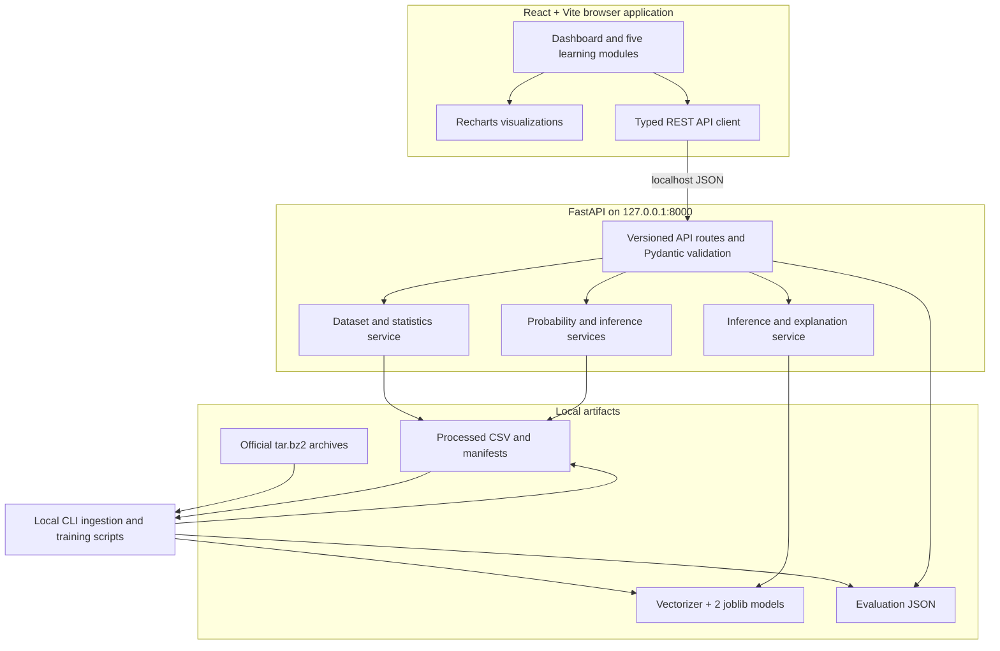

# MailSense — System Architecture and Technical Design

**Version:** 1.3 · **Date:** 2026-11-19 · **Status:** Scaffolds, pinned environments and corpus pipeline through split implemented; later components below remain planned

## 1. Architecture goals

- Support probability-first university demonstrations with an interactive, traceable interface.
- Keep dataset and all inference local to one machine.
- Train two Naive Bayes classifiers using a shared train-fitted vocabulary and deterministic split.
- Avoid a database, message storage service, authentication, cloud infrastructure or external prediction APIs.
- Separate pure statistical calculations from API and UI for independent mathematical testing.

## 2. Component overview



## 3. Responsibilities

| Module | Responsibilities | Explicit exclusions |
|---|---|---|
| React frontend | Routes, forms, tables, charts, transient state, understandable error handling | No statistical truth computed only in browser; no email persistence |
| FastAPI routes | JSON validation, request/response contracts, error envelope, server status | No login, cloud API, training endpoint |
| Dataset service | Read processed corpus, scope data, class summaries, descriptive statistics | No arbitrary raw file access via API |
| Probability service | 2×2 contingency, Bayes fractions, Bernoulli/binomial demonstrations | No smoothed model inference presented as empirical frequencies |
| Inference service | Pearson chi-square, Wilson interval, assumption warnings | No causal inference claims |
| Model service | Load trusted vectorizer + NB artifacts, classify transient input, compute explanations | No network lookups or continuous learning |
| CLI preprocessing | Extract official archives safely, MIME parsing, deduplication, split manifest | No runtime processing of arbitrary uploaded tarballs |
| CLI training | Fit shared vectorizer and both models, evaluate once on untouched test set, persist metadata | No model fit on test messages |

## 4. Repository layout (planned)

```text
mailsense/
├── README.md
├── .gitignore
├── frontend/
│   ├── package.json
│   ├── vite.config.js
│   └── src/
│       ├── App.jsx
│       ├── pages/
│       │   ├── Dashboard.jsx
│       │   ├── DatasetExplorer.jsx
│       │   ├── ProbabilityAnalysis.jsx
│       │   ├── StatisticalInference.jsx
│       │   ├── SpamDetector.jsx
│       │   └── ModelEvaluation.jsx
│       ├── components/
│       ├── services/api.js
│       └── hooks/
├── backend/
│   ├── requirements.txt
│   ├── app/
│   │   ├── main.py
│   │   ├── api/
│   │   ├── schemas/
│   │   ├── services/
│   │   │   ├── dataset.py
│   │   │   ├── descriptive.py
│   │   │   ├── probability.py
│   │   │   ├── inference.py
│   │   │   ├── models.py
│   │   │   └── explanations.py
│   │   └── core/
│   ├── scripts/
│   │   ├── ingest_corpus.py
│   │   └── train_models.py
│   └── tests/
├── data/
│   ├── raw/
│   └── processed/
├── artifacts/
│   ├── models/
│   └── reports/
└── docs/
    ├── PRD.md
    ├── SRD.md
    ├── SRS.md
    ├── API_CONTRACT.md
    ├── DATA_MODEL.md
    ├── APP_FLOW.md
    ├── ARCHITECTURE.md
    ├── STATISTICAL_METHODS.md
    ├── TEST_PLAN.md
    └── IMPLEMENTATION_PLAN.md
```

## 5. Processing pipeline

### 5.1 Corpus acquisition and parsing
1. Choose one latest coherent archive per corpus group from the official index, write manifest with source checksums. **Do not concatenate revisions** such as both `20021010_easy_ham` and `20030228_easy_ham` as independent records.
2. Stream verified archives with expanded-byte/member limits. Validate group-relative paths and reject traversal, links, sparse/special files and duplicates. Copy bounded candidate bytes to generated private staging names, never archive-provided filesystem paths/metadata. Ignore directory and `cmds` metadata entries. Do not execute MIME content.
3. Parse email with Python `email` module. Decode subject and plain-text MIME parts robustly. If no useful `text/plain` part is available, convert HTML text safely without rendering or fetching external links. Prefer one canonical body, not both HTML and plain text of the same multipart/alternative message.
4. Construct normalized subject + body `model_text`. Avoid transport headers, label signatures and SpamAssassin status fields as features.
5. Log skipped malformed/empty messages and content checksums. Reject exact-duplicate messages across groups; exclude conflicting-label duplicate text and log it.
6. Freeze retained records into `messages.csv`; compute `dataset_id`, class totals and explicit split manifest.

Steps 1–4 and parse diagnostics from step 5 are implemented by
`corpus_sources.py`, `corpus_ingest.py` and `mail_parser.py`, exposed through
the `download_corpus` and `ingest_corpus` CLI modules. Current private output is
`messages.parsed.jsonl`, before deduplication/token counts/split assignment.
The public parsing report pins input/output hashes, parser/runtime/limits and
candidate/accepted/rejected counts without text or raw member names.
Publication backs up prior artifacts, rolls back ordinary failures and verifies
the resulting record/report/source-manifest set. Acquisition and ingestion
share a preparation lock; abrupt interruption requires verification/rerun.
MSE-105 adds `corpus_dataset.py`, fixed `text_features.py` and the
`prepare_dataset` CLI. Verified parsed records are grouped by exact content
hash with text equality checked; conflicting-label groups are excluded in full,
otherwise the smallest stable ID is retained. Owner-only ignored `messages.csv`
keeps representative provenance and fixed token/character counts, without a
split. The public deduplication report pins input/output hashes, dataset identity,
versions/configuration, per-class/source counts and hash-only exclusion mappings.
Offline verification rederives the complete dataset/report. This stage shares
the lock/publication rollback helper with ingestion and leaves parser artifacts
unchanged. MSE-106 implements the split; later tickets own training and runtime
analytics. See [SETUP.md](SETUP.md).

### 5.2 Split and train
1. Stratified `train_test_split(test_size=0.2, random_state=42)` after deduplication.
2. Fit one `CountVectorizer` with documented tokenization parameters on **training messages only**.
3. Generate `X_train_counts` and `X_test_counts` from the same fitted vocabulary.
4. Fit `MultinomialNB(alpha=1.0)` using counts.
5. Fit `BernoulliNB(alpha=1.0)` using binary count presence. The Bernoulli model's full scoring includes absent terms.
6. Produce held-out predictions and confusion matrices for each model on **identical** test IDs, without adjusting settings based on test outcomes.
7. Save vectorizer, both trusted model artifacts, training metadata, split IDs and evaluation JSON.

Step 1 is implemented in `corpus_split.py` with the `split_dataset` CLI.
`load_dataset` rederives and verifies typed retained rows and their frozen CSV;
split preparation canonicalizes ID ordering, stratifies with seed 42 and writes
one shareable `split_manifest.json`. Its ID join supplies `split` in memory,
preserving upstream bytes and avoiding duplicate private CSVs. Membership and
input hashes, runtime/configuration and class counts verify by full rederivation.
Both labels must occur in both partitions; unsupported small/imbalanced inputs
fail explicitly. Steps 2–7 remain planned and must consume the verified train
scope without fitting on held-out rows.

### 5.3 Runtime classification
1. React validates pasted text, calls `POST /api/v1/predict`.
2. FastAPI validates input (1–50,000 trimmed characters), loads consistent artifacts from trusted paths, and vectorizes text without fitting.
3. The models return classes and `predict_proba` estimates. Backend extracts spam column according to `classes_`, **not** assumed fixed index.
4. Backend computes token/log-odds explanation contributions; for Bernoulli, present and absent-token effects are included in calculation and disclosed.
5. React displays both results, agreement, top factors and limitations. Backend does not store raw pasted text.

## 6. API architecture

All API endpoints are under `/api/v1`; see the authoritative `API_CONTRACT.md`. Core route groups:

```text
/health
/dataset/summary
/dataset/statistics
/dataset/distributions
/probability/word
/probability/distributions
/statistics/hypothesis-test
/statistics/confidence-interval
/predict
/models/metrics
/models/comparison
/models/explanations
```

A consistent JSON error structure and Pydantic validations apply to all route handlers. Training is CLI-driven, **not** a web endpoint.

## 7. Client design and state

- React Router provides six browser routes (`/`, `/dataset`, `/probability`, `/statistics`, `/detect`, `/evaluation`).
- Recharts renders numerical series received from the backend. UI formatting must not silently replace undefined values with zero.
- Use a small API module with central base URL, error translation and cancellation; state may be local or use a query cache library if already in the project, but none is required.
- Query controls: selected word, scope, metric, distribution trials/successes, confidence and alpha.
- Prediction inputs live only in component memory; do not place email content into URLs, analytics, browser storage or logs.
- Render arbitrary email content as plain text, not untrusted HTML.
- Direct route refresh works through Vite's development server fallback; production static hosting is out of scope.

## 8. Security, privacy and data-integrity boundaries

| Boundary | Control |
|---|---|
| Browser → API | Loopback binding and strict local CORS origins; no remote deployment; body-size/text-length validation |
| Third-party messages → parser | Parse, never execute; safe archive extraction; no attachment/URL fetching |
| Dataset → training | Dedupe before split, fit vocabulary on train only, no label-bearing feature leakage |
| Artifacts → runtime | Only load trusted joblib artifacts generated by local scripts; verify version/checksum/split IDs |
| API → response | Aggregates and predictions only; no full raw mail; hide tracebacks/system paths |
| Student email input → application | In-memory processing; avoid request-body logging, telemetry and persistent history |

Because there is no authentication, **the loopback-only deployment decision is a security requirement** rather than a convenience. Do not bind FastAPI to `0.0.0.0` by default.

## 9. Failure handling

- **Corpus not ready:** dataset endpoints `503`; dashboard reports missing data; no generated placeholder statistics.
- **Models not ready:** prediction/evaluation `503`; dataset/probability/inference modules remain usable when processed corpus exists.
- **Incompatible artifacts:** fail readiness checks; do not combine vectorizer/model files from different training runs.
- **Invalid word/text/scope:** `422`; user can correct without losing route.
- **Unobserved word:** empirical posterior returned as `null` with note; no divide-by-zero.
- **Stale request:** frontend cancels or ignores older response if controls have changed.
- **Unexpected backend exception:** safe error envelope, locally logged diagnostic without pasted body.

## 10. Observability and reproducibility

At ingestion, store selected filenames, checksum, number read/accepted/rejected/duplicate, preprocessing version and source URL. At training, store seed, split ID, vocabulary parameters, alpha, package versions and evaluation metrics. At runtime, log only structured operation names/status/timing; redact text.

A fixed random seed alone is not sufficient for cross-environment bit-for-bit reproducibility. Record dependency versions and processing rules, plus re-run determinism tests on the supported environment.

## 11. Architectural acceptance criteria

- Frontend uses API values; no hardcoded dataset/prediction results.
- Backend can run without internet after dependencies and corpus setup.
- `messages.csv` and model artifacts come from a documented CLI pipeline.
- Both classifiers share train-fitted vocabulary and held-out IDs.
- No production database, user account, mail provider or external message transmission exists.
- Project runs locally and passes the acceptance tests in `TEST_PLAN.md`.
