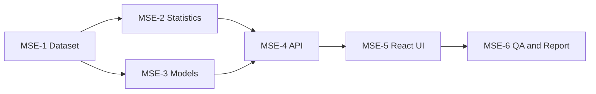

# MailSense — Implementation Plan and Jira-Style Backlog

**Version:** 1.0 · **Date:** 2026-11-19  
**Status:** MSE-101–104 scaffold, environment, acquisition and MIME parsing verified; 35 implementation tickets remain, starting with MSE-105. See the handoff for live status.
**Scope:** Complete university project, local React + FastAPI, SpamAssassin, Multinomial NB + Bernoulli NB

## 1. Delivery strategy

Prioritize the **data → mathematics → models → interface** path. Do not start with polished UI or compare test-set accuracy before basic parsing, mathematical checks and split integrity are proven. Work can be split across a small team, but dependencies in the backlog determine integration order.

Use lightweight tickets with: **ID, title, description, acceptance criteria, dependencies, estimate and evidence**. Estimates assume a competent student developer and are rough workload planning ranges, not promised dates.

## 2. Epics and work packages

### Preparation ticket — MSE-100

**Establish project memory and handoff.** Persist the user's Gravitas-first
analysis and planning workflow in `AGENTS.md` and indexed project memory. Add a
handoff covering completed preparation, all remaining tickets, verification,
blockers and the exact next task; establish sensitive-data ignore rules. Validate
the final files, then commit and push using a consistent Jira-style subject and
the configured author identity without added contributor credits.

This preparation ticket does not change product scope or complete MSE-101.
Current implementation status is maintained in [the handoff](../memory/HANDOFF.md).

### Preparation follow-up — MSE-107

**Consolidate project memory with Graphify.** Put the handoff, graph usage guide
and generated graph in `memory/`; preserve standing workflow instructions in
`AGENTS.md`. Remove redundant memory indexes and duplicate workflow records.
Build a source-grounded Graphify graph of documents, policies, ticket statuses
and dependencies with a reproducible local build and freshness/integrity checks.
Verify real Graphify query/path retrieval before committing and pushing.

This tooling ticket does not change the locked product scope or complete any of
the 39 implementation tickets below. Their live status is recorded in the handoff.

### Maintenance follow-up — MSE-108

**Keep agent tooling and generated/private files out of Git.** Ignore agent
installations and `.codex/`, `.gravitas/` and `.impeccable/` state, untrack
previously committed tooling without deleting local copies, and refresh the
Python/Node/cache/build/test/data ignore rules. Preserve application source,
lockfiles, shared memory, manifests, reports and empty directory placeholders.
Verify ignore behavior, local-file preservation, tracked-file cleanup, graph
freshness and shared-document usability from a clean exported checkout.

This maintenance task changes no application behavior. Current task status lives in the handoff.

### EPIC MSE-1 — Repository and data foundation (2–3 working days)

| ID | Story / task | Dependencies | Acceptance |
|---|---|---|---|
| MSE-101 | Initialize monorepo with `frontend/`, `backend/`, `docs/`, data/artifacts directories | None | React and FastAPI hello-world work separately; .gitignore excludes raw emails and artifacts |
| MSE-102 | Pin Python/Node dependencies and create environment setup notes | MSE-101 | Fresh local machine can install dependencies from documented commands |
| MSE-103 | Download one canonical official archive for each corpus group and create checksum/source manifest | MSE-101 | Manifests identify exact files/checksums; revisions not double-counted |
| MSE-104 | Implement safe extraction and MIME text parser | MSE-103 | Plain text/HTML/subject decoded; attachments ignored; parse failures counted |
| MSE-105 | Deduplicate, reject conflicting labels, derive summary records | MSE-104 | Unique retained texts and correct `spam`/`ham` labels; all exclusions logged |
| MSE-106 | Create reproducible stratified 80/20 split, seed 42 | MSE-105 | Split manifest hashes and disjoint IDs verified in tests |

**Gate 1:** Source manifest, processed data and train/test split are reproducible. Actual class counts reported; no training leakage through duplicates.

### EPIC MSE-2 — Statistics engine (3–5 working days)

| ID | Story / task | Dependencies | Acceptance |
|---|---|---|---|
| MSE-201 | Descriptive statistics for text length/token count | MSE-105 | Mean, median, mode, quartiles, sample variance and SD pass fixtures |
| MSE-202 | Distribution aggregations for histogram/box plot/top words | MSE-201 | Aggregates reconcile with input subset and are labeled by unit |
| MSE-203 | 2×2 word-document contingency and empirical probabilities | MSE-105 | Prior, joint, likelihood, posterior match 1,000-record synthetic example |
| MSE-204 | Bernoulli/binomial probability calculations | MSE-203 | PMF and assumption description pass unit tests |
| MSE-205 | Pearson chi-square with expected-count assumption checks | MSE-203 | χ² and df match known 2×2 table; no conclusion when unsuitable |
| MSE-206 | Wilson proportion confidence interval | MSE-201 | Known interval matches independent calculation |
| MSE-207 | Add unit tests and `STATISTICAL_METHODS.md` numerical verification evidence | MSE-201–206 | All formula tests pass and three worked examples documented |

**Gate 2:** The academic statistics work functions without a machine-learning model or UI. This demonstrates the course's mathematical content independently.

### EPIC MSE-3 — Model development (2–4 working days)

| ID | Story / task | Dependencies | Acceptance |
|---|---|---|---|
| MSE-301 | Fit one training-only CountVectorizer with stable tokens | MSE-106 | No test records influence vocabulary or token filtering |
| MSE-302 | Train MultinomialNB(alpha=1.0) on counts | MSE-301 | Model can predict on fixed-vocab vectors |
| MSE-303 | Train BernoulliNB(alpha=1.0) on binary presence | MSE-301 | Shares vocabulary and train/test IDs; correct binary input |
| MSE-304 | Persist trusted artifacts and metadata with checksums | MSE-302–303 | Model/vectorizer/split match or fail closed |
| MSE-305 | Evaluate both models on untouched held-out records | MSE-304 | Accuracy, precision, recall, F1, FPR and matrices reconcile |
| MSE-306 | Implement inference-time token explanations | MSE-304 | Correct log-odds directions; Bernoulli absent-feature contributions disclosed |
| MSE-307 | Save evaluation report and document limitations | MSE-305–306 | Same test set hash and positive class; no claimed calibrated probability |

**Gate 3:** Both models and evaluation reports exist, and model predictions can be run from Python without the frontend.

### EPIC MSE-4 — FastAPI integration (2–3 working days)

| ID | Story / task | Dependencies | Acceptance |
|---|---|---|---|
| MSE-401 | Health/readiness and shared error envelope | MSE-101 | Degraded/missing corpus/model states truthful |
| MSE-402 | Dataset summary/statistics/distributions routes | MSE-201–202 | Matches `API_CONTRACT.md`; typed validation |
| MSE-403 | Probability and statistical inference routes | MSE-203–206 | Synthetic known-answer API tests pass |
| MSE-404 | Prediction and model evaluation/explanation routes | MSE-304–307 | Both model results/metrics; safe invalid-input errors |
| MSE-405 | Harden local-only binding, CORS, redacted logging, input limits | MSE-401–404 | No external text leakage or unsafe file inputs |
| MSE-406 | Add FastAPI contract tests | MSE-402–405 | Normal/error JSON shapes and HTTP codes verified |

**Gate 4:** Every route in API contract responds from real local data/artifacts, not demo hardcoding.

### EPIC MSE-5 — React user interface (4–6 working days)

| ID | Story / task | Dependencies | Acceptance |
|---|---|---|---|
| MSE-501 | Shared layout, router, API client and loading/error components | MSE-101, MSE-401 | Six routes accessible with backend status shown |
| MSE-502 | Dataset Explorer with statistics charts | MSE-402, MSE-501 | Class cards, histogram, box plot and top words labeled |
| MSE-503 | Probability Analysis module | MSE-403, MSE-501 | 2×2 table, Bayes fractions and distributions usable |
| MSE-504 | Statistical Inference module | MSE-403, MSE-501 | Chi-square, expected counts/warnings and Wilson interval |
| MSE-505 | Spam Detector with dual-model cards | MSE-404, MSE-501 | Valid/invalid inputs, estimated probabilities and explanations |
| MSE-506 | Model Evaluation with confusion matrices | MSE-404, MSE-501 | Shared split, all metrics, FP/FN interpretations |
| MSE-507 | Responsive/keyboard/error state verification | MSE-502–506 | No misleading stale state; appropriate labeling |

**Gate 5:** Complete five-module guided demonstration works with real backend results.

### EPIC MSE-6 — Quality, report and release (2–3 working days)

| ID | Story / task | Dependencies | Acceptance |
|---|---|---|---|
| MSE-601 | Execute T01–T08 critical test scenarios | MSE-405–507 | All critical tests pass with execution evidence |
| MSE-602 | Security/privacy/offline and performance smoke tests | MSE-601 | Local-only behavior validated; timing/hardware recorded |
| MSE-603 | Verify math by hand, corpus provenance and model integrity | MSE-601 | Reproducibility checklist complete |
| MSE-604 | University report with formulas, screenshots, measured metrics and limitations | MSE-603 | No fabricated performance; clear statistical focus |
| MSE-605 | Final installation README and demo script | MSE-604 | Fresh local install and 8-step classroom demonstration complete |
| MSE-606 | Freeze version and list known limitations | MSE-605 | `v1.0` release checklist satisfied, deviations recorded |

**Gate 6:** Academic deliverables, source code, test evidence and demo are complete. No delivery claim before tests run.

## 3. Dependency and parallelization overview

Suggested assignment to a small team:
- **Data & ML:** MSE-1, MSE-3 and associated tests.
- **Statistics:** MSE-2 and formula verification.
- **Frontend/API:** MSE-4/5 once API responses are stable.
- **QA/docs:** MSE-6 and continuous documentation reviews.

A single developer should follow epic sequence, but could scaffold the frontend early without populating it with fake results.

## 4. Relative schedule

| Phase | Approx. duration | Notes |
|---|---:|---|
| 1. Repo + data | 2–3 workdays | Foundation |
| 2. Statistics engine | 3–5 workdays | Highest academic priority |
| 3. Both models | 2–4 workdays | Train-only vocabulary |
| 4. API integration | 2–3 workdays | Stable contracts |
| 5. React frontend | 4–6 workdays | Five modules |
| 6. Testing/docs | 2–3 workdays | Evidence and report |
| **Sequential rough total** | **15–24 workdays** | May change with expertise/team parallelism |

Dates are deliberately **not invented**. Convert to calendar milestones after confirming team members and deadline.

## 5. Definition of ready / done

**Task ready when:** associated requirement ID is known; dependencies available; input/output contract agreed; expected test is stated.  
**Task done when:** feature implemented, tests run and pass, sample/edge inputs checked, relevant docs updated, no hardcoded empirical results, and the task is reviewable locally.

## 6. Risks and mitigations

| Risk | Impact | Mitigation |
|---|---|---|
| Multiple dated archives duplicated | Inflated samples/data leakage | Use canonical per-group snapshot, source checksums, content dedup |
| Header-based label leakage | Artificially inflated classifier accuracy | Only subject/body text; no `X-Spam-Status` or folder names as predictors |
| Historical data treated as modern inbox | Incorrect conclusions | Explicit warnings in charts/report; no production claims |
| Misinterpretation of conditional probability | Academic inaccuracy | Display counts, denominators and worked tests |
| Bernoulli explanations ignore absent terms | Unfaithful explanations | Include absence contribution in score and disclosure |
| User assumes model probability = certainty | Overstated prediction | Label estimate; calibration not claimed |
| Local API unintentionally exposed to network | Privacy risk | Bind loopback; strict CORS; no email body logging |
| API/UI contract drift | Integration failures | Schema tests and single API contract version |
| Deadline pressure leads to UI-first development | Core mathematics unfinished | Gate 2 before polished UI |

## 7. Repository foundation checklist

- [x] Initialize the local repository and configure the existing GitHub remote.
- [x] Add all Markdown docs in `docs/`.
- [x] Add `.gitignore` for raw emails, processed message text, virtualenv, `node_modules`, and models; allow empty directory placeholders.
- [x] Create pinned runtime/dependency files and setup instructions; verify fresh installation for MSE-102.
- [x] Complete MSE-101 as the first implementation milestone with runtime/build evidence.
- [x] Record five canonical official archives, real acquisition metadata and verified SHA-256 values for MSE-103.
- [x] Safely parse the pinned archives to private canonical text with measured counts, diagnostics and reproducible hashes for MSE-104.

**Next task:** `MSE-105 — Deduplicate, reject conflicting labels and derive summary records`.
Keep status synchronized with `memory/HANDOFF.md`; later tickets remain open
until their acceptance criteria are verified.
