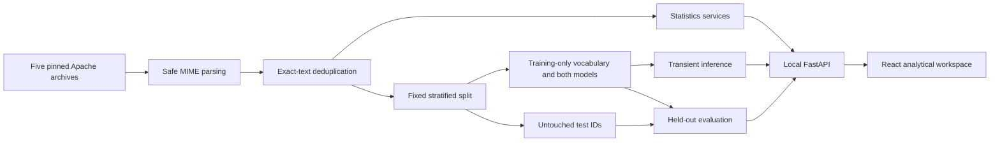
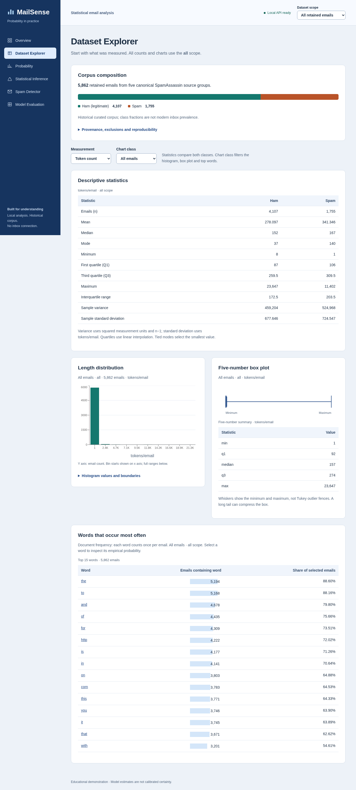
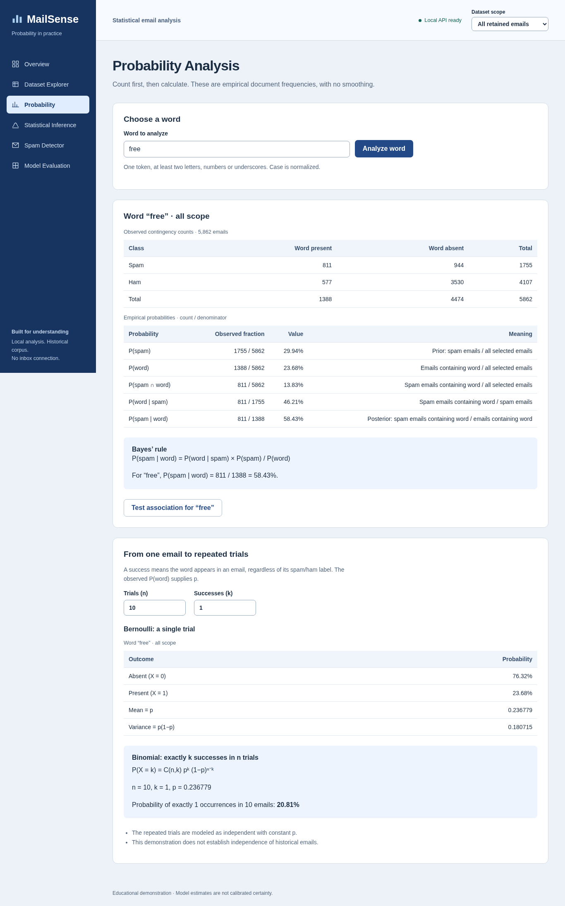
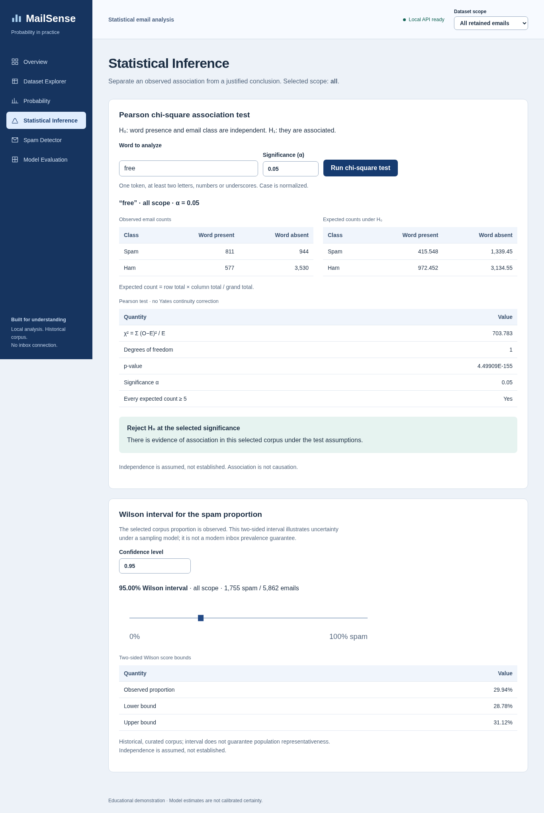
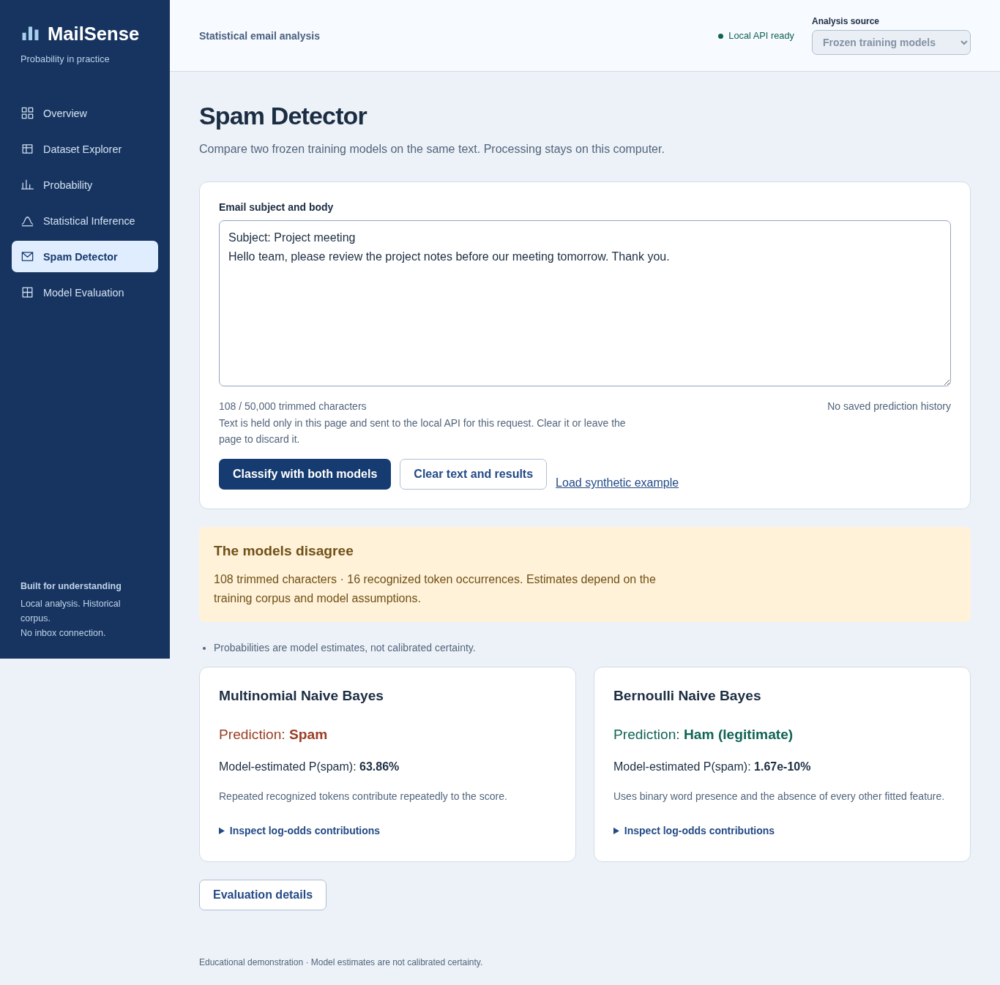

# MailSense: Statistical Analysis and Probabilistic Email Spam Detection

University project report · 19 November 2026

## Abstract

MailSense connects descriptive statistics, empirical probability, statistical
inference and probabilistic classification in a local browser application.
Five canonical Apache SpamAssassin archives produced 5,862 retained emails after
strict parsing and exact-text deduplication. A fixed stratified split allocates
4,689 records to training and 1,173 to evaluation. Multinomial and Bernoulli Naive
Bayes share a training-fitted vocabulary and smoothing parameter α=1. Their
measured test accuracies are 98.12% and 93.44%, respectively. Confusion counts,
denominators, assumptions and an authored disagreement accompany these scores.
The contribution is an inspectable statistical teaching workflow; these results
do not establish modern inbox performance or calibrated probabilities.

## 1. Objectives and scope

The project lets a student follow evidence from source records through counts,
formulas, uncertainty and classification errors. Its five modules provide:

1. Dataset provenance, class balance, descriptive summaries and distributions.
2. A word-presence contingency table, Bayes' theorem and distribution examples.
3. Pearson association testing and a Wilson interval for the spam proportion.
4. Two transient predictions with faithful log-odds explanations.
5. Evaluation on identical test records, including false-positive consequences.

The application runs on one computer without accounts, a database, live mail
integration or an external inference service. Corpus preparation and training
are separate CLI operations. Normal browser use reads frozen artifacts.

## 2. Architecture and reproducibility boundary



React/Vite/Recharts display the workspace at localhost:5173. FastAPI listens on
127.0.0.1:8000 and exposes twelve versioned routes. CSV, JSON and trusted local
joblib files provide storage. Exact environment pins include Python 3.12.15,
Node 22.23.5, NumPy 2.5.5, SciPy 1.18.1 and scikit-learn 1.9.1. Full dependency
locks and the [setup recipe](SETUP.md) define the remaining environment.

SHA-256 identities tie preparation, membership, vocabulary, models and metrics
together. Checksums detect mismatches; they do not authenticate arbitrary pickle
files. Only project-created model files are supported. The
[independent verifier](REPRODUCIBILITY.md) refits the approved models in memory
without calling application fitting or metric services. Learned arrays and
held-out predictions match exactly. It still uses the same pinned estimator
library, so this is independent wiring rather than an independent implementation
of scikit-learn.

## 3. Corpus, exclusions and preprocessing

The historical corpus is a curated selection. Apache documents its revisions,
retains original senders' text rights and warns against sending these messages
through live mail systems. Original emails remain local and are excluded from
this source distribution. [Apache corpus README](https://spamassassin.apache.org/old/publiccorpus/readme.html)

| Source group | Canonical archive | Retained records |
|---|---|---:|
| easy_ham | 20030228_easy_ham.tar.bz2 | 2,471 |
| easy_ham_2 | 20030228_easy_ham_2.tar.bz2 | 1,389 |
| hard_ham | 20030228_hard_ham.tar.bz2 | 247 |
| spam | 20030228_spam.tar.bz2 | 454 |
| spam_2 | 20050311_spam_2.tar.bz2 | 1,301 |
| **Total** | **Five groups** | **5,862** |

Archive hashes, sizes, official URLs and actual acquisition times are in the
[source manifest](../data/processed/source_manifest.json). They total 6,962,803
compressed bytes. Counts below are measured after processing, rather than copied
from the upstream description:

| Processing stage | Count |
|---|---:|
| Candidate messages | 6,046 |
| Malformed-MIME exclusions | 54 |
| Accepted parsed records | 5,992 |
| Same-label duplicate exclusions | 130 |
| Observed conflicting-label exclusions | 0 |
| Retained records | 5,862 |

Five directory entries and five control files are counted separately. Parsing
decodes subject/body MIME, prefers plain text over safe HTML fallback, ignores
attachments and remote resources, and normalizes Unicode NFC and whitespace.
Archive paths, member types and resource limits are checked before processing.
Strict MIME checks exclude some partly readable messages.

Exact normalized text hashes define duplicate groups. Same-label groups retain
one stable representative; conflicting groups would be removed entirely. The
fixed tokenizer lowercases Unicode text and uses `(?u)\b\w\w+\b` unigrams without
stop-word removal or accent stripping. Token count counts occurrences; document
frequency counts each word at most once per email. No test-derived feature
selection is performed.

The retained corpus contains 4,107 ham and 1,755 spam records. A shuffled,
label-stratified 80/20 split with seed 42 gives:

| Partition | Ham | Spam | Total |
|---|---:|---:|---:|
| Training | 3,285 | 1,404 | 4,689 |
| Test | 822 | 351 | 1,173 |

IDs and exact content hashes are disjoint. The shared vocabulary has 60,135
training features; 12,200 words observed only in test text remain excluded.
The [split manifest](../data/processed/split_manifest.json) records exact IDs.

## 4. Descriptive statistics

For measurements x₁,…,xₙ, the mean is Σxᵢ/n. Sample variance is
Σ(xᵢ−x̄)²/(n−1), and sample standard deviation is its square root. Median is
the middle ordered value, averaging the middle pair for even n. Tied modes
select the smallest value and expose a tie note. Quartiles use linear
interpolation at position (n−1)q. IQR is Q3−Q1. Sample variance/SD are undefined
for n<2; an empty group has no invented summary.

**Synthetic hand example:** `[2,4,4,6]` has mean=median=mode=4, Q1=3.5,
Q3=4.5, variance=8/3 and SD=1.632993. This four-element fixture is not a corpus
summary.

**Actual retained corpus, all scope, tokens per email:**

| Quantity | Ham | Spam |
|---|---:|---:|
| n | 4,107 | 1,755 |
| Mean | 278.096664 | 341.345869 |
| Median | 152 | 167 |
| Q1 | 87 | 106 |
| Q3 | 259.5 | 309.5 |
| Sample variance (tokens²) | 459,204.298739 | 524,968.295928 |
| Sample SD (tokens) | 677.646146 | 724.546959 |

The means exceed the medians and dispersion is large, consistent with long
right tails. Histograms disclose bin counts/boundaries. Box-plot whiskers show
minimum/maximum rather than Tukey fences, so extreme values can compress the box.



*Figure 1. Dataset Explorer, all retained records. Tables preserve readable
values when the distribution is highly skewed.*

## 5. Empirical probabilities and distributions

Let S mean spam and W mean presence of a selected word. Counts yield P(S), P(W),
P(S∩W), P(W|S) and P(S|W), each with an explicit denominator. Bayes' theorem is
P(S|W)=P(W|S)P(S)/P(W). An unobserved word has undefined P(S|W), not zero spam
probability. These empirical frequencies have no smoothing.

**Actual `free`, all scope:**

| Class | Present | Absent | Total |
|---|---:|---:|---:|
| Spam | 811 | 944 | 1,755 |
| Ham | 577 | 3,530 | 4,107 |
| Total | 1,388 | 4,474 | 5,862 |

Thus P(S)=1755/5862=.299386, P(W)=1388/5862=.236779,
P(W|S)=811/1755=.462108 and P(S|W)=811/1388=.584294.
A selected word's posterior is not the full classifier's prediction.

**Separate synthetic teaching table:** spam-present=180, spam-absent=120,
ham-present=70 and ham-absent=630, total=1,000. Here Bayes gives
(.6×.3)/.25=.72. Those numbers are unrelated to the measured corpus table.

A Bernoulli variable X indicates presence (1) or absence (0), with mean p and
variance p(1−p). Under independent equal-probability trials, the binomial model
gives P(K=k)=C(n,k)pᵏ(1−p)ⁿ⁻ᵏ. For the synthetic p=.25, n=10, k=1,
P(K=1)=.1877117156982422. This teaching model assumes independence and constant p;
it does not establish that historical email observations meet those assumptions.



*Figure 2. Measured `free` analysis. The pictured binomial calculation uses the
actual p=.236779, so its value differs from the separate synthetic p=.25 example.*

## 6. Statistical inference and uncertainty

Pearson's H₀ states that word presence and email class are independent; H₁ states
association. Expected counts are row-total×column-total/n. The statistic is
χ²=Σ(O−E)²/E with df=(2−1)(2−1)=1. MailSense explicitly disables Yates correction
and withholds the automatic decision when expected counts are too small or the
table is degenerate. These are the Pearson contingency-test quantities described
in the [SciPy reference](https://docs.scipy.org/doc/scipy/reference/generated/scipy.stats.chi2_contingency.html).

For the synthetic 1,000-record fixture, expected cells are `[75,225;175,525]`.
The contributions 147+49+63+21 sum to 280; p=7.509242653735255×10⁻⁶³.
For actual `free`, χ²=703.7827464379106 and p=4.499085288543703×10⁻¹⁵⁵.
All expected counts exceed five. At α=.05, reject H₀ under the approximation
and independence assumptions. A small p-value neither measures effect size nor
establishes causation. Trying many words is exploratory; no multiple-testing
adjustment is supplied.

This test concerns dependence between a word and the class. Naive Bayes instead
assumes conditional independence among features given the class. Rejecting this
H₀ does not test or refute that different assumption.

For a two-sided Wilson interval, let p̂=k/n, z=Φ⁻¹((1+c)/2) and d=1+z²/n.
The center is (p̂+z²/(2n))/d and the half-width is
z√(p̂(1−p̂)/n+z²/(4n²))/d. Bounds are center±half-width.
This is the score-interval construction associated with
[Wilson (1927)](https://doi.org/10.1080/01621459.1927.10502953).

For synthetic k=300,n=1000,c=.95, bounds are [.27240684,.32912386].
For actual k=1755,n=5862, bounds are [.28779624,.31123827] around .29938588.
The proportion is already observed for the selected corpus. The interval
illustrates repeated-sampling uncertainty under a model; it is not a 95%
probability that a fixed population parameter lies in these realized bounds,
and this curated historical selection does not justify a modern prevalence claim.



*Figure 3. Explicit counts, hypotheses, assumptions and interval denominators.*

## 7. Both Naive Bayes classifiers

For class c, the training prior is πc=Nc/N. With vocabulary size V and count
vector x, Multinomial uses θcj=(Ncj+1)/(ΣjNcj+V), with log score
log πc+Σjxj log θcj. Repeated tokens contribute repeatedly.

Bernoulli uses binary bj and θcj=(Dcj+1)/(Nc+2), where Dcj is the number of
training emails of class c containing feature j. Its score is
log πc+Σj[bj log θcj+(1−bj)log(1−θcj)]. Every absent fitted feature contributes.
Both classifiers normalize the class scores to obtain model-estimated P(spam).
Their distribution assumptions and the distinction between counts and binary
presence follow the [scikit-learn Naive Bayes reference](https://scikit-learn.org/stable/modules/naive_bayes.html).

No test-driven vocabulary or hyperparameter selection occurs. Unknown tokens
have no fitted weight and generate a warning. Explanations show signed log
posterior odds, class priors, strongest terms and a remainder; Bernoulli includes
the absent-feature aggregate. These are model decompositions, not causal effects
or independent percentage contributions.

**Authored disagreement, excluded from test metrics:**

```text
Subject: Project meeting
Hello team, please review the project notes before our meeting tomorrow. Thank you.
```

The intended class is ham. Multinomial predicts spam with P(spam)=.63855337728;
Bernoulli predicts ham with P(spam)=1.67016484723×10⁻¹². The false alarm relative
to authored intent and the large disagreement expose the limits of both models.
No original corpus message is reproduced.



*Figure 4. Two estimates on one transient authored input; disagreement stays visible.*

## 8. Measured held-out evaluation

Spam is positive. Actual classes form rows and predicted classes form columns:

| Model | TN | FP | FN | TP |
|---|---:|---:|---:|---:|
| Multinomial | 814 | 8 | 14 | 337 |
| Bernoulli | 815 | 7 | 70 | 281 |

Accuracy=(TP+TN)/N; precision=TP/(TP+FP); recall=TP/(TP+FN);
F1=2TP/(2TP+FP+FN); FPR=FP/(FP+TN). Undefined denominators remain undefined.

| Model | Accuracy | Precision | Recall | F1 | FPR |
|---|---:|---:|---:|---:|---:|
| Multinomial | 98.124467% | 97.681159% | 96.011396% | 96.839080% | 0.973236% |
| Bernoulli | 93.435635% | 97.569444% | 80.056980% | 87.949922% | 0.851582% |

Both confusion matrices sum to 1,173, with 822 actual ham and 351 actual spam.
Multinomial misses 14 spam and flags eight legitimate emails; Bernoulli misses
70 spam and flags seven legitimate emails. These are different observed error
profiles. A false positive could hide legitimate communication in a real system.
A single fixed split supplies no cross-validation variance, paired significance
test or guarantee that this ordering persists on new populations.

Exact values and identities are in the [evaluation report](../artifacts/reports/evaluation.json)
and [model card](MODEL_CARD.md). The test-ID SHA-256 shared by both models is
`64aef20395f55f37509281df5bf20a90846bf0e7b8b1a4842013df44b02a2629`.


*Figure 5. Same test IDs, explicit false positives/negatives and five metrics.*

## 9. Verification, local privacy and runtime measurements

As checked for MSE-603, 401 Python tests pass, covering mathematical fixtures,
ingestion, deduplication, split/model integrity, API validation and failure
handling. Eight frontend unit tests pass in the MSE-601 execution. Production
Chromium checks cover all six routes at 1366×900 and 390×844, keyboard flow,
stale responses, retries and transient input. T01–T08 execution evidence is in
the [acceptance report](../artifacts/reports/acceptance.json); its earlier snapshot
has 397 Python tests, before the four MSE-602 response-header regressions.
These counts describe separate observed runs, not 401 distinct end-to-end cases.

Real API stop/restart and missing-model recovery were exercised using an isolated
private copy. Corpus/model bytes remain unchanged. Pasted text is absent from
URLs, browser persistent storage and server logs. Foreign hosts/origins and
oversized requests are rejected; response errors are safe and noncacheable.
HTML-like input is text and creates no remote resource request.

With browser foreign requests blocked and API Python internet sockets denied,
all core workflows pass. This verifies independence from internet services at
those boundaries; it is not an OS-level disconnection test or a comprehensive
penetration test. Dependency advisory checks found zero reported vulnerabilities
and zero skipped packages at the recorded time, rather than proving absence of
unknown vulnerabilities. [Runtime verification](RUNTIME_VERIFICATION.md)

**Measured MSE-602 timings:** three warmups followed by 30 sequential full HTTP
requests per endpoint, nearest-rank p95, on Linux x86_64, Intel Core i5-13420H,
12 visible logical CPUs, backend Python 3.12.15. RAM was not measured.

| Operation | Median seconds | p95 seconds | Target seconds |
|---|---:|---:|---:|
| Dual prediction, synthetic 100-character input | 0.053498 | 0.064165 | 3 |
| Cached dataset summary | 0.037263 | 0.045441 | 5 |

Both targets pass on this machine. These measurements exclude cold startup,
installation and training; they do not measure maximum-length prediction or
concurrent load. Raw samples/hardware/method are in the
[runtime report](../artifacts/reports/runtime_smoke.json).

## 10. Limitations and future study

The main limitations are historical curation, nonrandom sampling, remaining near
duplicates/threads, strict-parser exclusions, one holdout and approximate
conditional independence. Probabilities are uncalibrated; near-zero estimates
are not certainty. Word association and Wilson intervals require assumptions
that this corpus does not establish. Language, phishing, adversarial robustness,
malware and attachments are not evaluated. Linux/Chromium is the verified setup;
other platforms and assistive technologies remain unmeasured.

A future study could use independently acquired temporal or thread-grouped
holdouts, evaluate calibration, and report uncertainty across repeated splits.
Such work would require a new evaluation protocol and must not tune against
this already inspected holdout while claiming it remains untouched.

MailSense meets its teaching purpose by exposing the quantities behind a result,
keeping empirical probability separate from fitted model estimates, and making
errors and uncertainty inspectable. The measured scores apply to the frozen
historical experiment described here.

## References and evidence

- Apache Software Foundation. [SpamAssassin public corpus index](https://spamassassin.apache.org/old/publiccorpus/)
  and [corpus README](https://spamassassin.apache.org/old/publiccorpus/readme.html).
- Wilson, E. B. (1927). *Probable Inference, the Law of Succession, and Statistical
  Inference*. Journal of the American Statistical Association, 22(158), 209–212.
  [DOI: 10.1080/01621459.1927.10502953](https://doi.org/10.1080/01621459.1927.10502953).
- scikit-learn. [Naive Bayes mathematical and implementation reference](https://scikit-learn.org/stable/modules/naive_bayes.html).
- SciPy. [Pearson contingency test reference](https://docs.scipy.org/doc/scipy/reference/generated/scipy.stats.chi2_contingency.html).
- Project evidence: [numerical verification](../artifacts/reports/statistics_verification.json),
  [independent reproducibility](../artifacts/reports/reproducibility.json),
  [test plan](TEST_PLAN.md), [screenshot provenance](report/figures/manifest.json).

External references checked on 19 November 2026. All five figures are inspected
production UI captures from MSE-507; they contain aggregates and explicitly
authored example text, not original emails. Source pixels are preserved.
