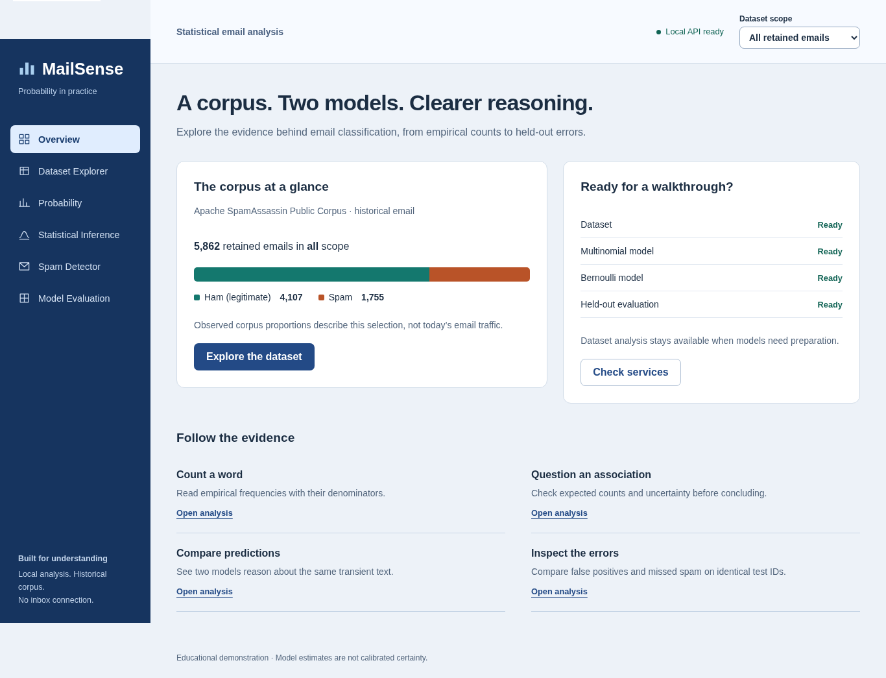
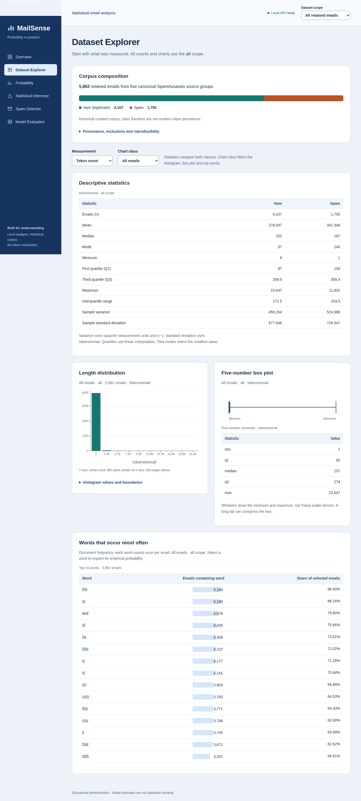
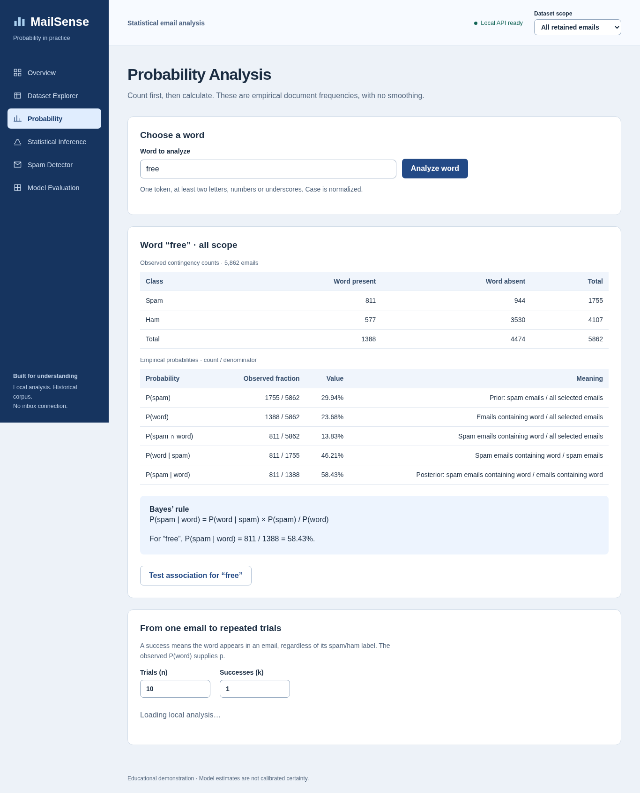
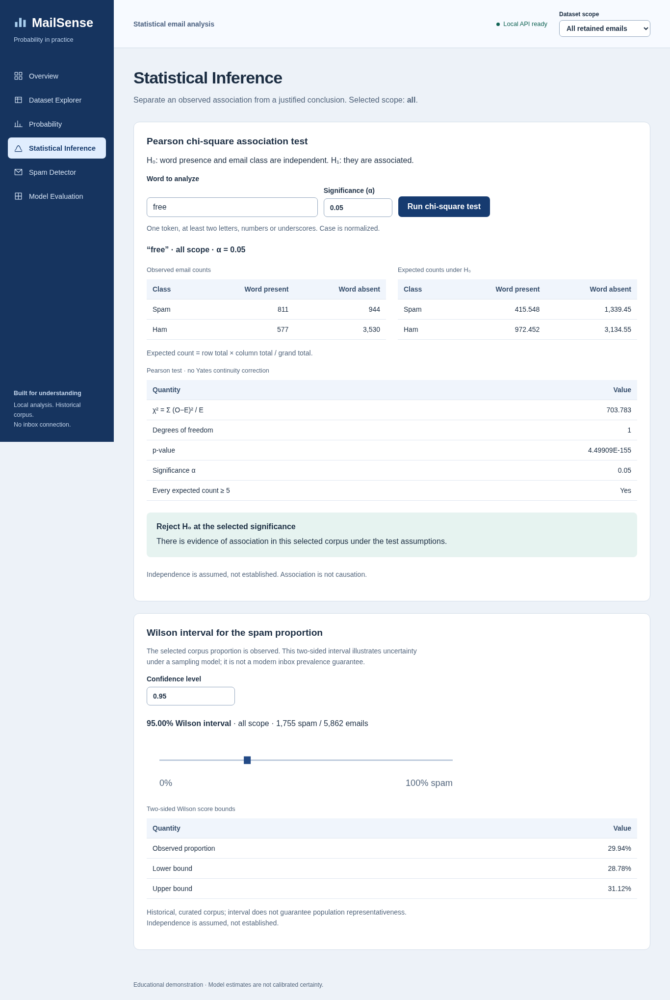
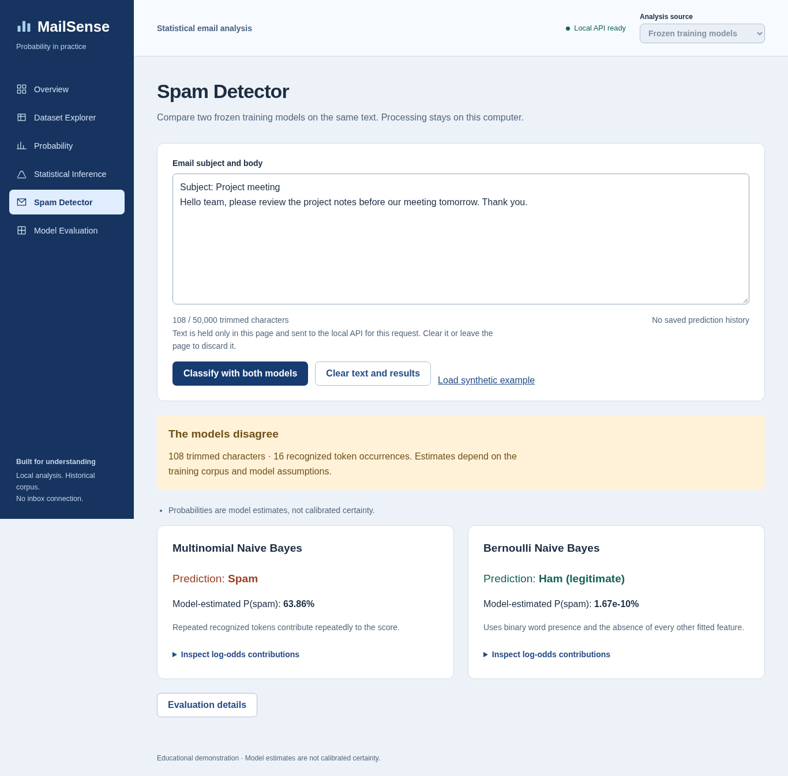
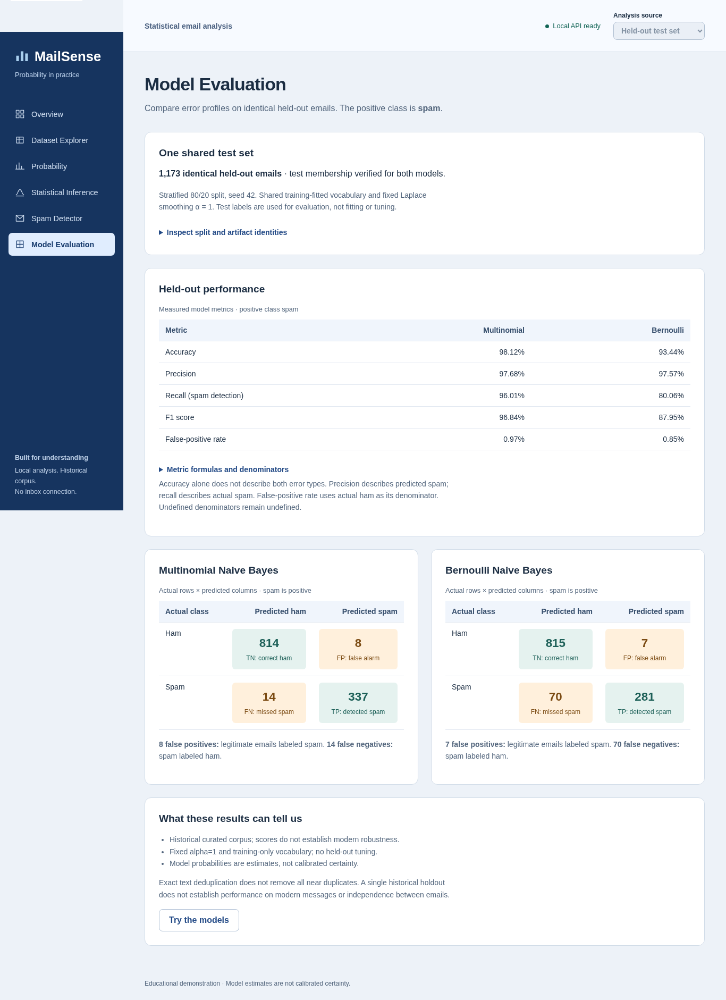

# MailSense Complete Platform Guide

User tutorial, statistical companion and maintainer reference

Five author fields and the instructor field are reserved blank in the DOCX/PDF.

## Contents

- [G01 · Project at a glance](#g01)
- [G02 · Technology stack and exact versions](#g02)
- [G03 · Install from a clean source checkout](#g03)
- [G04 · Prepare the corpus safely and reproducibly](#g04)
- [G05 · Verify statistics, train and freeze the models](#g05)
- [G06 · Start, verify and stop the platform](#g06)
- [G07 · Overview and shared navigation](#g07)
- [G08 · Dataset Explorer: the complete walkthrough](#g08)
- [G09 · Read descriptive summaries without misleading shortcuts](#g09)
- [G10 · Probability Analysis: controls and expected results](#g10)
- [G11 · Bayes, Bernoulli and binomial: worked tutorial](#g11)
- [G12 · Statistical Inference: run and read the screen](#g12)
- [G13 · Association and Wilson intervals: interpretation](#g13)
- [G14 · Spam Detector: classify the authored example](#g14)
- [G15 · Read explanations as full log-odds decompositions](#g15)
- [G16 · Model Evaluation: compare a fair experiment](#g16)
- [G17 · Metric arithmetic and real confusion counts](#g17)
- [G18 · The research extension: pairing and bootstrap](#g18)
- [G19 · Research effects and conditional error costs](#g19)
- [G20 · Eight-step classroom demonstration and talk plan](#g20)
- [G21 · Architecture: preparation, analysis and requests](#g21)
- [G22 · Frontend implementation and accessible behavior](#g22)
- [G23 · Backend implementation and readiness semantics](#g23)
- [G24 · All twelve API routes and principal parameters](#g24)
- [G25 · API examples, validation and safe errors](#g25)
- [G26 · Data, models and public artifacts](#g26)
- [G27 · Naive Bayes formulas and faithful explanations](#g27)
- [G28 · Security, privacy and offline boundaries](#g28)
- [G29 · Verification layers and recorded evidence](#g29)
- [G30 · Commands for testing, browser checks and offline proof](#g30)
- [G31 · Performance method and what was not measured](#g31)
- [G32 · Maintenance, intentional updates and fresh provenance](#g32)
- [G33 · Troubleshooting and safe recovery](#g33)
- [G34 · Workflow tools, memory and source-control delivery](#g34)
- [G35 · Implementation history and completed gates](#g35)
- [G36 · Glossary for probability and model evaluation](#g36)
- [G37 · Practice tasks with answers](#g37)
- [G38 · Viva and presentation questions](#g38)
- [G39 · Document map, literature and editable outputs](#g39)
- [G40 · References and further reading](#g40)
- [G41 · Appendix: Backend resolved dependencies (1–26 of 35)](#g41)
- [G42 · Appendix: Backend resolved dependencies (27–35 of 35)](#g42)
- [G43 · Appendix: Frontend resolved dependencies (1–32 of 213)](#g43)
- [G44 · Appendix: Frontend resolved dependencies (33–64 of 213)](#g44)
- [G45 · Appendix: Frontend resolved dependencies (65–96 of 213)](#g45)
- [G46 · Appendix: Frontend resolved dependencies (97–128 of 213)](#g46)
- [G47 · Appendix: Frontend resolved dependencies (129–160 of 213)](#g47)
- [G48 · Appendix: Frontend resolved dependencies (161–192 of 213)](#g48)
- [G49 · Appendix: Frontend resolved dependencies (193–213 of 213)](#g49)
- [G50 · Appendix: Publication tool environment (1–17 of 17)](#g50)
- [G51 · Appendix: Graph-memory environment (1–26 of 31)](#g51)
- [G52 · Appendix: Graph-memory environment (27–31 of 31)](#g52)
- [G53 · Appendix: individual delivery tickets (1–21)](#g53)
- [G54 · Appendix: individual delivery tickets (22–42)](#g54)
- [G55 · Appendix: every CLI entry point and output](#g55)

<a id="g01"></a>

## G01 · Project at a glance

MailSense is a local university application that connects probability and statistics to email spam classification. It has an overview and five learning modules. Students inspect real counts, calculate probabilities, test an association, obtain two predictions and interpret held-out errors. The interface reads frozen prepared artifacts; normal use never trains a model.

| Audience | Start here |
| --- | --- |
| New user | Install and prepare, then follow the screen tutorials. |
| Presenter | Read the eight-step demo, PowerPoint notes and viva questions. |
| Developer | Study architecture, API, artifact contracts and maintenance. |
| Research reader | Read paired inference, uncertainty, effects and the conference paper. |

### What is implemented

- All 39 original application tickets and six release gates are complete.
- MSE-607 adds an eight-page paper and reproducible secondary statistical analysis.
- MSE-608 adds the 30-slide presentation; MSE-609 is this complete guide.

### Scope boundary

There are no accounts, live inbox connection, mail sending, quarantine, cloud inference, arbitrary dataset uploads, runtime retraining or prediction history. The study uses historical Apache SpamAssassin messages. Reported accuracy applies to that fixed benchmark. The PDF paper and this guide do not establish a modern email-security guarantee.

A complete source clone contains code, locks, manifests and aggregate reports. It does not contain original mail, processed text, trained models, virtual environments or local agent installations. Prepare those private inputs before expecting full readiness.

Sources: [README.md](../../README.md), [PRODUCT.md](../../PRODUCT.md), [docs/RELEASE.md](../RELEASE.md)


<a id="g02"></a>

## G02 · Technology stack and exact versions

The application stack is pinned for reproducibility. Version numbers below are repository requirements and recorded environment versions, not recommendations to install the latest release. Publication and graph-memory tools use separate environments.

| Layer | Tools and role |
| --- | --- |
| Browser UI | React 19.3.1 / React DOM: components and state; Recharts 3.11.0: charts; react-is: compatible element checks. |
| Frontend tooling | Vite 8.3.8; React plugin 6.3.0; ESLint 10.15.0; Playwright core 1.57.0; Node 22.23.5/npm 10.9.9. |
| API | Python 3.12.15; FastAPI 0.165.0; Uvicorn 0.54.0; Pydantic via the frozen lock. |
| Numerical work | NumPy 2.5.5; Pandas 3.1.1; SciPy 1.18.1; scikit-learn 1.9.1; joblib 1.6.0. |
| Backend checks | pytest 9.2.0; Ruff 0.17.5; httpx2 2.16.2; uv 0.13.9 manages Python/dependencies. |
| Publications | python-pptx 1.0.2; python-docx 1.2.0; Matplotlib 3.10.7; PyMuPDF 1.26.6; local LibreOffice export. |
| Project memory | Graphify 0.9.112, isolated under memory/.venv; no external model call is needed to build the graph. |

Linux x86_64 is the verified setup. The Node wrapper has Linux arm64/macOS selections, which are untested here; native Windows is unsupported by that wrapper. Chromium 143/151 are recorded. Firefox, Safari, physical touch devices and assistive-technology sessions were not exercised.

The appendices list every resolved frontend/backend dependency and all installed publication/memory dependencies. Entries are environment-specific, so the same library may appear more than once. Optional platform packages in locks are not a claim that they ran on the demo computer.

The supplied snapshot has 35 registry entries in the backend lock and 213 frontend packages, plus 17 publication and 31 graph-memory distributions: 296 environment-specific entries. The recorded Linux backend installation had 33 packages; lock entries include platform-specific alternatives.

Sources: [frontend/package.json](../../frontend/package.json), [backend/pyproject.toml](../../backend/pyproject.toml), [memory/requirements.txt](../../memory/requirements.txt), [docs/learning/requirements.txt](requirements.txt)


<a id="g03"></a>

## G03 · Install from a clean source checkout

### Prerequisites

Use Git, a Python 3.12+ bootstrap interpreter, uv 0.13.9 and initial internet access. The application itself uses exactly Python 3.12.15. All commands in this guide start at the repository root unless another directory is explicitly named. No system Node repair is needed.

```bash
git clone https://github.com/hixam001/mail-sense.git
cd mail-sense
uv --version
python3 scripts/node.py install
python3 scripts/node.py node --version
python3 scripts/node.py npm --version
python3 scripts/node.py npm --prefix frontend ci
uv sync --project backend --frozen
```

1. Confirm Node 22.23.5 and npm 10.9.9. The wrapper verifies an official download checksum and installs under ignored .tools/.
2. Confirm uv reports 0.13.9. Frozen sync installs the pinned Python environment at backend/.venv, including development checks.
3. Keep frontend/package-lock.json, backend/uv.lock and the hashed runtime export unchanged during routine setup.
4. Continue through corpus preparation and model training. Installing packages alone does not make the app ready.

### Expected first-run state

A source-only clone has public metadata but no private archives, message CSV or saved models. The UI may open while health reports preparation needed. That is expected and does not mean the project has an empty corpus. Do not copy old report hashes into files or force-add private artifacts to make readiness appear green.

Sources: [docs/SETUP.md](../SETUP.md), [scripts/node.py](../../scripts/node.py), [README.md](../../README.md)


<a id="g04"></a>

## G04 · Prepare the corpus safely and reproducibly

Prepare in dependency order. Downloads use five fixed official Apache HTTPS URLs; redirects, checksum mismatches and unsafe local paths are rejected. Archives total 6,962, 803 compressed bytes. Initial acquisition needs network access; matching complete-cache reuse and all verify actions are offline.

```bash
uv run --directory backend --frozen python -m scripts.download_corpus download
uv run --directory backend --frozen python -m scripts.download_corpus verify
uv run --directory backend --frozen python -m scripts.ingest_corpus run
uv run --directory backend --frozen python -m scripts.ingest_corpus verify
uv run --directory backend --frozen python -m scripts.prepare_dataset run
uv run --directory backend --frozen python -m scripts.prepare_dataset verify
uv run --directory backend --frozen python -m scripts.split_dataset run
uv run --directory backend --frozen python -m scripts.split_dataset verify
```

| Stage | Actual output |
| --- | --- |
| Parse | 6,046 candidates →5,992 accepted; 54 malformed-MIME rejections. |
| Retain | 130 same-label duplicate exclusions; 0 observed label conflicts →5,862 records. |
| Class totals | 4,107 ham; 1,755 spam. |
| Split | 4,689 train (3,285/1,404 ham/spam); 1,173 test (822/351). |

MIME parsing chooses subject/body text, prefers plain text in alternatives and falls back to safe HTML-to-text. Attachments, scripts/styles and remote resources are ignored. It normalizes NFC/whitespace, bounds resources and rejects unsafe archive members. Exact normalized-text hashes define duplicates before splitting; the stable representative is retained. All records in a label-conflict group would be excluded. No conflict occurred in this corpus.

The split is shuffled, label-stratified 80/20 with seed 42. Test size rounds up; training is the complement. IDs and exact content hashes are disjoint. Near duplicates and shared threads can remain.

Sources: [docs/SETUP.md](../SETUP.md), [docs/DATA_MODEL.md](../DATA_MODEL.md), [data/processed/source_manifest.json](../../data/processed/source_manifest.json)


<a id="g05"></a>

## G05 · Verify statistics, train and freeze the models

After splitting, run these offline stages. Each run creates or reconciles its own report/artifacts; verify recomputes and rejects mismatches. Do not proceed past a nonzero exit. Data preparation, fitting and evaluation have no browser upload or training endpoint.

```bash
uv run --directory backend --frozen python -m scripts.verify_statistics run
uv run --directory backend --frozen python -m scripts.verify_statistics verify
uv run --directory backend --frozen python -m scripts.train_models run
uv run --directory backend --frozen python -m scripts.train_models verify
uv run --directory backend --frozen python -m scripts.evaluate_models run
uv run --directory backend --frozen python -m scripts.evaluate_models verify
uv run --directory backend --frozen python -m scripts.verify_science run
uv run --directory backend --frozen python -m scripts.verify_science verify
```

- One 60,135-feature vectorizer fits training text only. All 12,200 test-only tokens remain excluded.
- Both models use α=1 and training class priors. Multinomial uses counts; Bernoulli uses binary presence and absence.
- The evaluation report uses identical 1173 held-out IDs for both models, with spam positive.
- The independent scientific verifier checks hand examples, hashes, membership, vocabulary and separately wired in-memory refits. It uses the same pinned estimator library.

Only trusted project-created joblib files are supported. Hash checks detect corruption or inconsistent artifacts; they are not signatures that authenticate arbitrary pickle files. New acquisition/training UTC times can legitimately change provenance identities while counts, membership, vocabulary, learned arrays and predictions reproduce. Regenerate downstream stages rather than editing identities.

Sources: [docs/REPRODUCIBILITY.md](../REPRODUCIBILITY.md), [docs/MODEL_CARD.md](../MODEL_CARD.md), [docs/SETUP.md](../SETUP.md)


<a id="g06"></a>

## G06 · Start, verify and stop the platform

### Terminal 1: API

```bash
uv run --directory backend --frozen python -m scripts.serve
```

### Terminal 2: development UI

```bash
python3 scripts/node.py npm --prefix frontend run dev
```

1. Open http://localhost:5173/. Keep the API process running in its own terminal.
2. The API listens only at 127.0.0.1:8000. Readiness is /api/v1/health; the schema is /openapi.json.
3. The overview should show dataset, both models and held-out evaluation ready. Check services after a restore or restart.
4. Stop only processes you own with Ctrl+C in their terminals. Do not kill another user’s listener just to reuse a port.

### Production UI preview

Stop the development UI first. Development and preview deliberately share port 5173, because the API allows those fixed loopback origins.

```bash
python3 scripts/node.py npm --prefix frontend run build
python3 scripts/node.py npm --prefix frontend run preview
```

Preview is a built frontend, not a replacement API. Keep the API running. The launcher disables raw URL access logs and forwarded-proxy trust, and preserves the local privacy policy. Swagger/Redoc CDN pages are disabled; use local OpenAPI JSON. Do not assume a configurable arbitrary API host or port exists.

Initial downloads require internet. After complete preparation, ordinary browser analysis and inference need only the two local processes. There is no service-worker or offline-install guarantee if required packages/artifacts are missing.

Sources: [README.md](../../README.md), [backend/scripts/serve.py](../../backend/scripts/serve.py), [frontend/vite.config.js](../../frontend/vite.config.js)


<a id="g07"></a>

## G07 · Overview and shared navigation



Overview with actual readiness and corpus totals; local aggregate data only.

1. Open the Overview route /. Read the Local API ready / Preparation needed / API unavailable status.
2. Inspect separate readiness for dataset, Multinomial, Bernoulli and evaluation. Dataset analysis may stay usable when a model is missing.
3. Use Dataset scope: All retained emails, Training subset or Test subset. Related analytical pages share this in-memory selection.
4. Use the left rail on desktop or horizontal navigation on a narrow screen. The active route remains visible; browser back/forward works.
5. Select Check services to retry readiness. Health also refreshes periodically and when the window regains focus.

Detector shows the fixed analysis source Frozen training models. Evaluation shows Held-out test set. Their source controls are disabled to prevent a misleading all/train/test model switch. A page reload resets transient state; the app has no persistent user history.

Sources: [frontend/src/App.jsx](../../frontend/src/App.jsx), [frontend/src/pages/Dashboard.jsx](../../frontend/src/pages/Dashboard.jsx)


<a id="g08"></a>

## G08 · Dataset Explorer: the complete walkthrough



Dataset Explorer: retained composition and chart controls.

1. Open /dataset with All retained emails. Confirm 5, 862 emails, 4, 107 ham and 1, 755 spam.
2. Expand Provenance, exclusions and reproducibility. Read source groups, official URLs, acquisition times, hashes, 54 MIME rejections and 130 duplicates.
3. Change Measurement between Token count and Character count. Check the units next to each table/chart.
4. Change Chart class to All emails, Ham or Spam. This filters histogram, five-number plot and top words; the descriptive table still compares both classes.
5. Expand Histogram values and boundaries to inspect exact bins. Read the five-number table alongside its plot.
6. Select a word in the Top 15 document-frequency list to open Probability Analysis for that word.

Scope and chart class are different controls. Exclusion counts are global pre-split counts, not per-partition errors. A histogram bin includes its lower boundary and excludes its upper boundary, except the final bin includes both. Whiskers are min/max, not Tukey fences.

Sources: [frontend/src/pages/Dataset.jsx](../../frontend/src/pages/Dataset.jsx), [docs/DATA_MODEL.md](../DATA_MODEL.md)


<a id="g09"></a>

## G09 · Read descriptive summaries without misleading shortcuts

| Tokens/email, all scope | Ham | Spam |
| --- | --- | --- |
| Mean | 278.097 | 341.346 |
| Median | 152.000 | 167.000 |
| Q1 | 87.000 | 106.000 |
| Q3 | 259.500 | 309.500 |
| Sample variance | 459,204.299 | 524,968.296 |
| Sample SD | 677.646 | 724.547 |

### Definitions and units

```text
Mean =Σxᵢ/n; sample variance =Σ(xᵢ−mean)²/(n−1)
```

```text
Sample SD =sqrt(sample variance); IQR =Q3−Q1
```

Median is the middle ordered value, or mean of the middle pair. Quartiles use linear interpolation at position(n−1)q. For a tied mode, the smallest tied value is shown with a note. Sample variance/SD are undefined below two observations; empty groups have no invented values. Variance uses squared units, while SD uses the original measurement unit.

### Separate hand fixture

[2, 4, 4, 6] has sum 16, mean/median/mode 4, squared-deviation sum 8, sample variance 8/3, SD≈1.633, Q1=3.5 and Q3=4.5. These four numbers are a synthetic verification fixture, not corpus measurements.

Actual means exceed medians and dispersion is large, consistent with long right tails. A min/max whisker can compress the central box when an extreme record is large. Use the numerical table and bin boundaries; do not label every long record a statistical outlier or infer that length alone classifies mail.

Sources: [docs/STATISTICAL_METHODS.md](../STATISTICAL_METHODS.md), [artifacts/reports/statistics_verification.json](../../artifacts/reports/statistics_verification.json)


<a id="g10"></a>

## G10 · Probability Analysis: controls and expected results



Probability Analysis with actual free document counts.

1. Open /probability. Enter free, or follow a top-word link from Dataset Explorer.
2. Press Analyze word. Inspect the observed 2×2 table and its row/column totals.
3. Read each numerator and denominator: prior, word prevalence, joint event, word-given-spam and spam-given-word.
4. Set Trials(n)=10 and Successes(k)=1 for the repeated-trial demonstration. Keep the displayed scope visible.
5. Choose Test association for free to carry the normalized word to Statistical Inference.

A valid word is one Unicode token, at least two letters/numbers/underscores and at most 64 raw input code points; case is lowered and NFC applied. FREE is valid; free offer, free!, and a single letter are invalid. Draft edits hide stale results. Trials must be integer 1..100 and k integer 0..n. A valid unseen token has undefined P(spam|word), not 0% spam.

Sources: [frontend/src/pages/Probability.jsx](../../frontend/src/pages/Probability.jsx), [frontend/src/lib/validation.js](../../frontend/src/lib/validation.js)


<a id="g11"></a>

## G11 · Bayes, Bernoulli and binomial: worked tutorial

| Class | free present | free absent | Total |
| --- | --- | --- | --- |
| Spam | 811 | 944 | 1,755 |
| Ham | 577 | 3,530 | 4,107 |
| Total | 1,388 | 4,474 | 5,862 |

```text
P(spam)=1755/5862; P(free)=1388/5862
```

```text
P(free|spam)=811/1755; P(spam|free)=811/1388≈.584294
```

Bayes gives P(spam|free)=P(free|spam)P(spam)/P(free), which agrees with the direct fraction. Presence counts each email once even if the token repeats. The empirical table has no smoothing. It is a one-word description of the selected scope, not a full-message model prediction.

### One event, then repeated trials

```text
Bernoulli: X=1 for presence,0 for absence; E[X]=p; Var[X]=p(1−p)
```

```text
Binomial: P(K=k)=C(n,k)p^k(1−p)^(n−k)
```

With actual free p=1388/5862, n=10, k=1, the UI shows about 20.81%. With a separate synthetic p=.25, the same n/k gives.1877117157, or 18.77%. Do not mix these probabilities. The repeated-trial model assumes independent emails and constant p; those assumptions are not established by a curated corpus.

### Another independent fixture

The synthetic table [180,120; 70,630] totals 1,000. It gives P(spam)=.3, P(word)=.25, P(word|spam)=.6 and posterior.72. It is used for hand checks and must never be substituted for the measured 5,862-record table.

Sources: [docs/STATISTICAL_METHODS.md](../STATISTICAL_METHODS.md), [docs/REPRODUCIBILITY.md](../REPRODUCIBILITY.md)


<a id="g12"></a>

## G12 · Statistical Inference: run and read the screen



Inference form, explicit test action and observed/expected counts.

1. Open /statistics from Probability or the rail. Choose the word and all/train/test scope.
2. Keep Significance(α)=.05, or enter a finite value strictly between 0 and 1. Press Run chi-square test.
3. Compare the observed and expected tables. Read χ², degrees of freedom, p-value and the expected-count check.
4. Read the null/alternative and conditional decision. If the table is degenerate or expected counts are unsuitable, there is no automatic decision.
5. Keep Confidence level=.95, or choose 0.80–0.99. Read the Wilson point estimate, denominator and numerical bounds.

Changing word, scope or alpha hides a prior test result. Back navigation does not silently rerun a POST. The interval is requested separately. A successful request does not prove independent sampling or population representativeness; those limitations are displayed alongside the numbers.

Sources: [frontend/src/pages/Statistics.jsx](../../frontend/src/pages/Statistics.jsx), [backend/app/schemas/probability.py](../../backend/app/schemas/probability.py)


<a id="g13"></a>

## G13 · Association and Wilson intervals: interpretation

### Pearson association

```text
Expected cell =row total×column total/n; χ²=Σ(O−E)²/E
```

The null states that word presence and email class are independent; the alternative states association. For a 2×2 table, df=1. MailSense uses Pearson without Yates correction and checks expected counts. For actual free, χ²=703.782746 and p≈4.499085e-155; every expected count exceeds 5. At α=.05, the app rejects the null under the approximation and independence assumptions.

A p-value is not an effect size, a probability that the null is true, or evidence of causation. Trying many words is exploratory; no multiple-testing adjustment is supplied. Word/class association is a different hypothesis from Naive Bayes conditional independence among features given the class.

### Wilson 95% interval

```text
d=1+z²/n; center=(p̂+z²/(2n))/d
```

```text
half=z sqrt[p̂(1−p̂)/n+z²/(4n²)]/d; bounds=center±half
```

At 95%, z≈1.959964. Actual spam proportion 1755/5862≈.299386 has bounds [.287796,.311238]. The synthetic 300/1000 fixture gives [.272407,.329124]. The selected corpus proportion is already observed. The interval illustrates uncertainty under a sampling model, not current inbox prevalence or a 95% probability that a fixed parameter lies in these realized bounds.

Wilson handles proportions near the boundaries more sensibly than treating a tiny observed error rate as exact. Its denominator must match the quantity: all test messages for accuracy, actual spam for recall, actual ham for FPR, predicted spam for precision. The paper also uses paired bootstrap intervals for differences.

Sources: [docs/STATISTICAL_METHODS.md](../STATISTICAL_METHODS.md), [docs/paper/manuscript.json](../paper/manuscript.json)


<a id="g14"></a>

## G14 · Spam Detector: classify the authored example



Detector input form; the synthetic example is authored teaching text.

1. Open /detect. The source is fixed to Frozen training models.
2. Choose Load synthetic example, then Classify with both models.
3. Read both predictions and the agreement/disagreement message. The result heading receives focus for keyboard users.
4. For the project-meeting example, Multinomial labels spam (P≈.638553), Bernoulli ham (P≈1.670165e-12). The intended authored class is ham.
5. Choose Clear text and results, or leave the detector, to discard the transient text.

The detector accepts 1..50,000 trimmed Unicode code points. Blank/whitespace, overlong and control-only input is rejected; no text is truncated. The submit button is disabled for invalid input or an active request. Editing during a request hides/discards an outdated result. The 512 KiB wire-body limit is separate and can reject unusually escaped JSON even below the character cap.

Sources: [frontend/src/pages/Detect.jsx](../../frontend/src/pages/Detect.jsx), [frontend/src/lib/validation.js](../../frontend/src/lib/validation.js)


<a id="g15"></a>

## G15 · Read explanations as full log-odds decompositions


Both frozen model results for the authored meeting example.

1. Expand Inspect log-odds contributions under each model. Read positive (spam-favoring) and negative (ham-favoring) signed terms.
2. Add the class prior, displayed strongest present-token terms, other-present remainder and absent-feature aggregate. They reconstruct the full log posterior odds.
3. Click a displayed token for its general vocabulary weight. A general weight is not the full effect of one word on every message.
4. Use Evaluation details to inspect historical test errors before treating a prediction as dependable.

```text
Full log odds =prior+displayed terms+other present terms+absent aggregate
```

Multinomial terms include token repetition; Bernoulli uses presence and includes absence of every other fitted feature. Top terms alone are incomplete without the remainder and absence aggregate. These are model score contributions, not probability percentages or causal explanations. Unknown vocabulary has no invented weight and produces a warning.

The authored disagreement is outside held-out metrics. It shows why a high benchmark accuracy and a near-zero estimated probability do not establish certainty for an individual email.

Sources: [backend/app/services/prediction.py](../../backend/app/services/prediction.py), [docs/MODEL_CARD.md](../MODEL_CARD.md)


<a id="g16"></a>

## G16 · Model Evaluation: compare a fair experiment



Evaluation uses identical held-out IDs and displays source metadata.

1. Open /evaluation. The source is fixed to Held-out test set.
2. Inspect the shared split, 1, 173 test messages, α=1 and training-only vocabulary. Expand identities if needed.
3. Compare all five metrics. Open Metric formulas and denominators rather than ranking by accuracy alone.
4. Read Actual rows×predicted columns in each confusion matrix. Spam is the positive class.
5. Explain false alarms (legitimate mail labeled spam) separately from missed spam. The comparison blocks inconsistent test identities.

No training occurs when you change route, reload or use the comparison. The metrics are persisted outputs of the fixed experiment. Missing or contradictory evaluations produce an error instead of a fabricated winner. All-scope class proportions on the analytical pages do not change the detector priors or test membership.

Sources: [frontend/src/pages/Evaluation.jsx](../../frontend/src/pages/Evaluation.jsx), [frontend/src/lib/evaluation.js](../../frontend/src/lib/evaluation.js)


<a id="g17"></a>

## G17 · Metric arithmetic and real confusion counts

| Model | TN | FP | FN | TP |
| --- | --- | --- | --- | --- |
| Multinomial | 814 | 8 | 14 | 337 |
| Bernoulli | 815 | 7 | 70 | 281 |

| Metric | Formula /denominator | Multinomial | Bernoulli |
| --- | --- | --- | --- |
| Accuracy | (TP+TN)/N | 98.12% | 93.44% |
| Precision | TP/(TP+FP) | 97.68% | 97.57% |
| Recall | TP/(TP+FN) | 96.01% | 80.06% |
| F1 | 2TP/(2TP+FP+FN) | 96.84% | 87.95% |
| FPR | FP/(FP+TN) | 0.97% | 0.85% |

Each matrix sums 1,173:822 actual ham and 351 actual spam. Multinomial accuracy is 1151/1173; recall 337/351; FPR 8/822. Bernoulli accuracy is 1096/1173; recall 281/351; FPR 7/822. Similar precision does not mean similar recall. Undefined denominators remain undefined rather than being forced to zero.

A false positive could hide legitimate communication in a deployed filter; MailSense itself never sends, blocks or quarantines mail. The observed tradeoff is 14 versus 70 missed spam and 8 versus 7 false alarms. It is one historical test composition, not a modern population guarantee.

### Separate hand fixture

TN 135, FP 5, FN 10, TP 50 gives accuracy.925, precision.90909, recall.83333, F1.869565 and FPR.035714. Those synthetic counts test arithmetic and are not the measured classifier results.

Sources: [artifacts/reports/evaluation.json](../../artifacts/reports/evaluation.json), [docs/STATISTICAL_METHODS.md](../STATISTICAL_METHODS.md)


<a id="g18"></a>

## G18 · The research extension: pairing and bootstrap

| Paired outcome | Messages |
| --- | --- |
| Both correct | 1,092 |
| Only Multinomial correct | 59 |
| Only Bernoulli correct | 4 |
| Both wrong | 18 |

The paper extends the fixed application with joint error analysis. Of 63 discordant correctness pairs, 59 favor Multinomial and 4 favor Bernoulli. The exact two-sided binomial McNemar p-value is 1.38212575e-13 under equal marginal errors and independent message pairs. Separate confusion matrices cannot reveal this overlap.

| M−B difference | Point(pp) | Paired95% interval(pp) |
| --- | --- | --- |
| Accuracy | 4.69 | [3.50, 5.97] |
| Spam recall | 15.95 | [12.25, 19.94] |
| FPR | 0.12 | [-0.36, 0.73] |

The 10,000 bootstrap samples use seed 20261122, keep 822 ham/351 spam, and resample both predictions together. Drawing multinomial counts over the four paired cells within each class is equivalent. The 2.5th and 97.5th percentiles use linear interpolation. All differences are Multinomial minus Bernoulli in percentage points, not relative percent improvement.

Accuracy/recall intervals exceed zero; FPR includes zero. The result is mainly 57 additional spam detections unique to Multinomial versus one unique to Bernoulli, offset by one net extra false alarm. Intervals condition on fitted models/class counts, omit training variability and assume within-class exchangeability. Near duplicates/threads may make them optimistic.

```bash
uv run --directory backend --frozen python -m scripts.analyze_paper run
uv run --directory backend --frozen python -m scripts.analyze_paper verify
```

These are research CLI results, not extra live UI widgets. The holdout had already been inspected; the analysis is secondary/exploratory, with no new independent test or tuning claim.

Sources: [docs/PAPER.md](../PAPER.md), [artifacts/reports/paper_statistics.json](../../artifacts/reports/paper_statistics.json)


<a id="g19"></a>

## G19 · Research effects and conditional error costs

### Word association beyond the p-value

For free in all retained records, OR=811×3530/(944×577)=5.2559, with a 95% exponentiated log-scale interval [4.6214, 5.9775]. Phi=sqrt(703.782746/5862)=.34649. P(spam|present)=58.43%, versus 21.10% when absent. The odds ratio is not a posterior probability ratio or a causal effect.

```text
SE(log OR)=sqrt(1/a+1/b+1/c+1/d)
```

The uncorrected four-cell estimate is appropriate for these positive, large counts. Word choice is an established teaching example; it is not a multiple-testing-adjusted discovery. These descriptive effects were not used to select vocabulary, smoothing or a model.

### A hypothetical cost policy

```text
L(M)=8λ+14; L(B)=7λ+70; L(M)−L(B)=λ−56
```

| False-positive cost λ | M loss | B loss |
| --- | --- | --- |
| 1 | 22 | 77 |
| 10 | 94 | 140 |
| 56 | 462 | 462 |
| 100 | 814 | 770 |

One missed spam has unit cost; λ is the cost of one false alarm. At current decisions, observed losses tie at 56. This is a sensitivity calculation, not a measured user preference or recommended threshold. The break-even depends on only one net false-positive difference and can be unstable. No decisions were retuned.

The eight-page paper includes ten references, five tables and two directly relevant scientific figures. Its five author spaces and instructor are blank. DOCX/PDF and sources are under docs/paper/. Five editing passes and rendered-page checks were completed; an institutional similarity percentage was not measured.

Sources: [docs/paper/manuscript.json](../paper/manuscript.json), [artifacts/reports/paper_statistics.json](../../artifacts/reports/paper_statistics.json)


<a id="g20"></a>

## G20 · Eight-step classroom demonstration and talk plan

| Step | Action and expected evidence |
| --- | --- |
| 1 Ready | Start both processes; show four readiness states and local operation. |
| 2 Explore | Show 5,862 retained records, exclusions, units and two distributions. |
| 3 Count | Analyze free; derive 811/1388 posterior. |
| 4 Distributions | Use n=10, k=1; distinguish actual p from the synthetic.25 fixture. |
| 5 Infer | Run Pearson at.05; inspect expected counts and Wilson.95 interval. |
| 6 Predict | Load authored meeting email; compare labels and expand full scores. |
| 7 Evaluate | Same 1,173 IDs; read FP/FN and correct denominators. |
| 8 Recover | Show empty-input helper/disabled submit; stop your API, show outage, restart/retry. |

Use the 30-slide PowerPoint as a narrative: slides 1–6 scope/data/design; 7–17 module/math/model results; 18–21 new paired research; 22 demo; 23–27 evidence/limits/takeaways; 28 references; 29–30 technical appendices. Speaker notes contain explanations and source locations. Suggested talk 20 minutes plus a 10–15 minute demo is a delivery plan, not a performance claim.

Use only the labeled authored example during the presentation. Do not delete real models to stage a fault; the automated failure runner uses its own private copy. Explain corpus age, single holdout, dependence and uncalibrated probabilities at the end. A rehearsal is documented, not an attended examiner signoff.

```bash
python3 scripts/browser_check.py --production
python3 scripts/release_check.py
```

Install the optional test browser first and stop existing app servers for unambiguous owned processes. The runners clean up only processes they start. Clear the text after showing the example.

Sources: [docs/DEMO.md](../DEMO.md), [docs/learning/presenter_notes.md](presenter_notes.md)


<a id="g21"></a>

## G21 · Architecture: preparation, analysis and requests

Separate the lifecycle into two paths. Preparation acquires/parses/retains/splits data, verifies mathematics, fits the shared vectorizer/models and evaluates the fixed test set. Runtime loads verified artifacts and serves read-only analytics or transient inference. Normal UI requests do not acquire data or fit parameters.

| Layer /boundary | Responsibility |
| --- | --- |
| React pages/components | Controls, source labels, tables/charts, accessible states and navigation. |
| API client /request hook | Fixed local origin; endpoint allowlist; timeout/abort; discard stale responses. |
| FastAPI routes +schemas | Parse validated fields, dispatch services and return typed safe responses. |
| ApplicationState | Readiness and content-hash-bound cached snapshots for data/models/evaluation. |
| Pure/domain services | Counts, distributions, inference, model loading and faithful prediction scores. |
| Local files | Private archives/text/models; public provenance, membership and aggregate reports. |

1. A route change or form submission selects an allowlisted API call.
2. The API validates parameters/body and obtains a consistent artifact snapshot.
3. A service calculates or reads a result; no original email body enters aggregate responses.
4. React renders loading/error/empty/result states and rejects out-of-date responses.

The same dataset/split/test/vocabulary identities link the layers. Hashes detect drift in actual bytes, rather than trusting filenames or modification times alone. Missing models need not disable unrelated dataset analytics. There is no SQL database, authentication server or external inference dependency.

Sources: [docs/ARCHITECTURE.md](../ARCHITECTURE.md), [backend/app/core/state.py](../../backend/app/core/state.py), [frontend/src/lib/api.js](../../frontend/src/lib/api.js)


<a id="g22"></a>

## G22 · Frontend implementation and accessible behavior

| Source | Implemented role |
| --- | --- |
| src/App.jsx | History navigation, rail, shared scope/selected word, health refresh, fixed source labels and route lazy loading. |
| src/pages/*.jsx | Dashboard, Dataset, Probability, Statistics, Detect and Evaluation. |
| src/lib/api.js | Fixed API origin, endpoint allowlist, no credentials/cache/redirects/referrer, 15s timeout. |
| src/lib/useApi.js | AbortController and per-request generations stop late or abandoned results. |
| src/lib/validation.js | Unicode token rules, n/k bounds and trimmed Unicode text-length checks. |
| src/lib/evaluation.js | Reject mismatched test IDs/counts/positive class/confusion totals. |
| src/lib/format.js | Undefined values and tiny/near-one probabilities stay meaningful. |
| src/components/* | AsyncPanel, DataTable, WordForm, BoxPlot, number/balance/notes and focus helpers. |

The design uses an atlas-blue rail, pale-blue workspace, white analysis panels, teal ham and burnt-orange spam. Labels accompany colors. Charts have table/text equivalents. A skip link, semantic landmarks, visible focus and focused result headings support keyboard use. Reduced motion removes the class-band animation.

On narrow screens the rail becomes horizontal navigation and paired areas stack. Active navigation reveals itself on route/size changes. General wide tables can scroll inside labeled containers; mobile model metrics/matrices fit without horizontal scrolling. Recorded checks are focused accessibility verification, not formal conformance or assistive-technology testing.

Email state is local to the detector and disappears on clear/unmount/reload. Draft edits hide old output. Five rapid submit clicks must not create duplicate active predictions. A late response from word A cannot replace current word B, including returning to A later.

Sources: [DESIGN.md](../../DESIGN.md), [docs/UI_VERIFICATION.md](../UI_VERIFICATION.md), [frontend/src/lib/useApi.js](../../frontend/src/lib/useApi.js)


<a id="g23"></a>

## G23 · Backend implementation and readiness semantics

| Area | Key files /behavior |
| --- | --- |
| Application factory | app/main.py: create_app; root greeting; twelve versioned routes; local OpenAPI. |
| Readiness/cache | core/state.py: verify dataset/model/evaluation identities and cache by content hashes. |
| Transport boundary | core/local_boundary.py: allowed hosts/origins, body/query bounds and safe headers. |
| API dispatch | api/dataset.py, probability.py, models.py, validation.py and errors.py. |
| Schemas | Pydantic models for data, probability, models and safe common errors; forbid extra POST fields. |
| Corpus domain | corpus_sources, mail_parser, corpus_ingest, corpus_dataset, corpus_split, text_features. |
| Analysis/model domain | analytics_data, descriptive, distributions, probability, inference, numerical_verification, model_features, training, model_store, evaluation, prediction. |

Health returns a truthful ready/degraded state rather than fabricated values. Dataset readiness, both model states and matching evaluation are checked separately. Model loading validates every file hash before deserializing trusted local joblib bytes and validates classes/features afterward. Dataset-only analytical endpoints can remain usable when models are unavailable.

Unexpected failures are wrapped in a safe envelope without raw inputs, local paths or tracebacks. Ordinary request logs contain method, static route and status, not raw URLs or pasted text. Direct public responses contain derived quantities rather than original email records. The API does not expose arbitrary file paths, upload, corpus downloads or training.

Backend services are independently testable without the frontend. Artifact verifiers rederive deterministic outputs from pinned inputs; the paper analyzer reads existing models and has its own known-answer fixtures. These layers support a measured release claim rather than relying on interface screenshots alone.

Sources: [backend/app/main.py](../../backend/app/main.py), [backend/app/core/state.py](../../backend/app/core/state.py), [docs/API_CONTRACT.md](../API_CONTRACT.md)


<a id="g24"></a>

## G24 · All twelve API routes and principal parameters

Base URL: http://127.0.0.1:8000/api/v1. All scope values are all/train/test. Model values are multinomial/bernoulli. OpenAPI JSON is available at the unversioned /openapi.json. See the supplied api_schema.json for every response field and validation constraint.

| Method /path | Principal inputs /purpose |
| --- | --- |
| GET /health | No input; readiness and blockers. |
| GET /dataset/summary | scope=all; retained/source/exclusion totals and identities. |
| GET /dataset/statistics | scope=all; metric=token_count or character_count. |
| GET /dataset/distributions | Required metric(token_count/character_count/top_words); scope; class_label=all/ham/spam; top_n=15(range 1..30). |
| GET /probability/word | Required word; scope=all; document contingency and five fractions. |
| GET /probability/distributions | word; scope; trials=10(range 1..100); successes=1(range 0..n). |
| POST /statistics/hypothesis-test | JSON word, scope=all, alpha=.05(strict 0<α<1). |
| GET /statistics/confidence-interval | scope=all; confidence=.95(range 0.80–0.99). |
| POST /predict | JSON text; 1..50000 trimmed code points, bounded wire body. |
| GET /models/metrics | Required model; one frozen held-out result. |
| GET /models/comparison | No inputs; both results on matching test IDs. |
| GET /models/explanations | Required model and word; general learned token effect. |

Training, preparation and research paired analysis remain CLI-only. A model route is not a request to train a different model. Query/body validation uses safe field names/error types rather than echoing user data.

Sources: [docs/API_CONTRACT.md](../API_CONTRACT.md), [docs/learning/api_schema.json](api_schema.json)


<a id="g25"></a>

## G25 · API examples, validation and safe errors

### Probability and explicit inference

```bash
curl "http://127.0.0.1:8000/api/v1/probability/word?word=free&scope=all"
curl -X POST "http://127.0.0.1:8000/api/v1/statistics/hypothesis-test" \
  -H "Content-Type: application/json" \
  -d '{"word":"free","scope":"all","alpha":0.05}'
```

### Transient authored input

```bash
curl -X POST "http://127.0.0.1:8000/api/v1/predict" \
  -H "Content-Type: application/json" \
  -d '{"text":"Subject: Project meeting. Please review the notes."}'
```

The short text in this curl example differs from the exact meeting example in the UI, so its predicted probabilities must not be assumed equal. Use the labeled UI example for the recorded.638553/1.67e-12 result. Responses include counts/results/explanations, not an echoed input body. API errors use the envelope below:

```text
{
  "error": {
    "code": "INVALID_INPUT",
    "message": "Request parameters are invalid.",
    "details": {"fields": [{"field": "word", "type": "value_error"}]}
  }
}
```

| Status | Meaning |
| --- | --- |
| 400 /403 | Rejected Host / Origin boundary. |
| 404 | Unknown route. |
| 413 /414 | Wire body / query too large. |
| 422 | Invalid known fields, extra fields, token, range or text. |
| 503 | Missing/inconsistent required artifacts; prepare/recover locally. |
| 500 | Safe unexpected failure; do not expose paths/traces/inputs. |

Prefer the fixed launcher and UI client. Foreign origins are rejected before parsing. Allowed local error responses retain no-store/nosniff and readable local CORS policy. A valid host is not permission to send corpus mail through a live system.

Sources: [docs/API_CONTRACT.md](../API_CONTRACT.md), [backend/app/api/errors.py](../../backend/app/api/errors.py)


<a id="g26"></a>

## G26 · Data, models and public artifacts

| Location | Role /distribution policy |
| --- | --- |
| data/raw/*.tar.bz2 | Pinned original archives; ignored/private. |
| messages.parsed.jsonl | Accepted canonical subject/body records before deduplication; ignored. |
| messages.csv | Retained text/provenance, content hash, character/token counts and warnings; ignored. |
| source_manifest.json | Official URLs/groups/labels, UTC acquisition, SHA-256/sizes and parsing counters; public. |
| parsing_report.json /deduplication_report.json | Aggregate counts/hashes, rejection/exclusion ledger; public, no original text. |
| split_manifest.json | Sorted membership IDs, seed/configuration and hashes; public. CSV bytes remain frozen; split is joined in memory by ID. |
| artifacts/models/ | vectorizer.joblib, multinomial.joblib, bernoulli.joblib, metadata.json; trusted local private set. |
| artifacts/reports/ | Statistics/evaluation/reproducibility, acceptance/runtime/offline/audit/fresh-install/release, paper and publication receipts; public aggregates. |

Dataset ID, split ID, train/test membership hashes, vocabulary hash and artifact ID have different meanings. They tie a result to exact inputs/configuration. Models must agree with the same feature map and split; evaluation must match the stored generation. A byte hash proves equality/integrity, not authorship or safety of an arbitrary pickle.

Raw/parsed/retained text and models remain ignored. Public ledgers can include stable hash IDs but not original mail bodies or member names. The CSV uses quoted multiline fields and a field limit of 1,000, 000 characters. Split metadata is not duplicated into that CSV; use the split-aware loader for selecting train/test.

After a new download, actual timestamps and provenance-dependent report hashes may differ. Do not compare only artifact filenames or rewrite a timestamp to force identity. Rerun affected stages in order and check the scientific outcomes separately from acquisition identity.

Sources: [docs/DATA_MODEL.md](../DATA_MODEL.md), [docs/REPRODUCIBILITY.md](../REPRODUCIBILITY.md)


<a id="g27"></a>

## G27 · Naive Bayes formulas and faithful explanations

### Shared features and training priors

Both classifiers use the same Unicode unigrams, no stop words/accent stripping, training-only vocabulary and α=1. Class prior π[c]=N[c]/N comes from training records. Analytical all/train/test scope does not change these fitted parameters.

Text is normalized to NFC and lower case. The Unicode token pattern (?u)\b\w\w+\b keeps unigrams of at least two word characters. There is no stop-word list, accent stripping, stemming or test-fitted vocabulary.

### Multinomial

```text
θ[c,j]=(T[c,j]+1)/(Σk T[c,k]+V)
```

```text
scoreM(c,x)=log π[c]+Σj x[j]log θ[c,j]
```

T[c, j] counts training occurrences of token j in class c; V is 60,135. Repeated tokens contribute repeatedly. The multinomial coefficient is common across classes and does not affect class selection. No vocabulary is fitted on test text.

### Bernoulli

```text
q[c,j]=(D[c,j]+1)/(N[c]+2)
```

```text
scoreB(c,b)=log π[c]+Σj{b[j]log q[c,j]+(1−b[j])log(1−q[c,j])}
```

D[c, j] counts training documents containing j; b[j] is binary presence. Every absent fitted feature contributes. Applying Multinomial to binary data would still be a different model from this Bernoulli score because the absence term and smoothing denominator differ.

### Normalize and explain

The class with the larger score is predicted; normalized class scores supply the reported spam estimate. The class column is located by its spam label rather than assumed column order. Log posterior odds are score(spam)−score(ham). Top token contributions, remainder, prior and absence reconstruct that full quantity. Estimates are uncalibrated; a near-zero or near-one number is not certainty.

The paper compares fixed fitted classifiers, not every model that a learning algorithm could produce under new training data. Future calibration or threshold experiments need an independent protocol and should not retune against this inspected holdout while calling it untouched.

Sources: [docs/STATISTICAL_METHODS.md](../STATISTICAL_METHODS.md), [backend/app/services/training.py](../../backend/app/services/training.py), [backend/app/services/prediction.py](../../backend/app/services/prediction.py)


<a id="g28"></a>

## G28 · Security, privacy and offline boundaries

- Loopback-only launcher: no LAN/public bind, forwarded-proxy trust or arbitrary runtime inference host.
- Explicit localhost/127.0.0.1/IPv6 loopback UI origins on 5173; no credentials.
- Prediction text is absent from persistent browser history, URLs and normal server logs.
- HTML-like input remains text; attachments/scripts/remote resources are not executed or fetched.
- 512 KiB body, 4 KiB query and 1..50000 trimmed code-point limits are separate safeguards.
- Artifact hashes are checked before trusted local joblib deserialization; no uploaded pickle path exists.
- Corpus archive traversal, links, sparse/special/duplicate members and resource expansion are checked.

The release review corrected missing ordinary safety headers on early errors and local CORS headers on unexpected errors. Four regression cases established the fix. A focused review/smoke check and advisory lookup were performed, not a comprehensive penetration test or proof against unknown vulnerabilities.

### Offline evidence

The boundary smoke denies non-loopback browser requests and API internet sockets, including a blocked probe. The stronger Linux test runs that workflow in a separate child user/network namespace with only loopback and no external routes. A test socket fails with kernel ENETUNREACH; all six pages and both predictions still work. The parent network is unchanged.

After dependencies, corpus, models and optional test browser are prepared, normal app use needs no external service. Initial downloads/advisory checks need internet. The optional Graphify HTML viewer uses a CDN; local graph build/query do not, and that viewer is separate from MailSense runtime. Preserve upstream corpus restrictions and original message rights.

Sources: [docs/RUNTIME_VERIFICATION.md](../RUNTIME_VERIFICATION.md), [docs/RELEASE.md](../RELEASE.md), [scripts/offline_check.py](../../scripts/offline_check.py)


<a id="g29"></a>

## G29 · Verification layers and recorded evidence

| Evidence | Recorded outcome |
| --- | --- |
| Unit/integration | v1.0.0 release 413 Python tests; paper adds 5 known-answer tests →418. Eight frontend tests in recorded release runs. |
| Mathematics | Descriptive/Bayes/binomial/Pearson/Wilson fixtures and independently wired refits reconcile. |
| Corpus/model integrity | Actual archives, exclusion counts, deterministic IDs/content isolation, training-only vocabulary and confusion metrics verified. |
| Browser | Six routes at 1366×900 and 390×844; keyboard focus, stale/duplicate requests, privacy, empty/error/retry and unknown routes. |
| Critical T01–T08 | Actual provenance/math/model/API scenarios; real API stop/restart, missing-model recovery and 50,000-character boundary. |
| Fresh install | Separate source-only checkout, fresh environments/data/models, official downloads and matching scientific results. |
| Offline/performance | Guarded and OS-level offline workflow; full HTTP warmed samples with hardware. |
| Dependency lookup | Zero reported npm/Python advisories and zero skips at recorded timestamp; not a continuing guarantee. |

Dates matter: core release evidence is Nov 19, 2026; the paper extension is 22 November 2026. Publication work on 24 November 2026 reuses those measured results. Capturing current tutorial screenshots checks visible readiness/results, but is not a rerun of every application unit, security, performance or browser test.

T01 source ingestion, T02 duplicate/split isolation, T03 descriptive math, T04 probability, T05 inference, T06 fair models/metrics, T07 prediction validation and T08 unavailable-backend/missing-artifact recovery are release-blocking scenarios. A single screenshot cannot substitute for those tests. No formal accessibility conformance or external examiner signoff is claimed. Current guide captures use Chromium 158.0.8127.42 at 1366 × 900; only visible readiness/results were exercised in that capture.

Sources: [docs/TEST_PLAN.md](../TEST_PLAN.md), [artifacts/reports/release.json](../../artifacts/reports/release.json), [artifacts/reports/paper_document.json](../../artifacts/reports/paper_document.json)


<a id="g30"></a>

## G30 · Commands for testing, browser checks and offline proof

### Routine application checks

```bash
python3 scripts/node.py npm --prefix frontend run lint
python3 scripts/node.py npm --prefix frontend test
python3 scripts/node.py npm --prefix frontend run build
uv run --project backend --frozen ruff check \
  --config backend/pyproject.toml backend/app backend/tests backend/scripts scripts
uv run --project backend --frozen pytest \
  -c backend/pyproject.toml backend/tests scripts/tests
```

### Optional browser, failure and security checks

```bash
python3 scripts/node.py node frontend/node_modules/playwright-core/cli.js install chromium
python3 scripts/browser_check.py --production
python3 scripts/release_check.py
python3 scripts/smoke_check.py
python3 scripts/offline_check.py
python3 scripts/dependency_check.py
```

The one-time browser install and advisory lookup require network access. An existing trusted Chromium can be passed using --browser /absolute/path/to/chromium. Linux offline_check additionally needs unshare(util-linux), ip(iproute2) and permitted user/network namespaces. Normal app use needs none of those namespace tools.

Stop existing app servers before failure/offline runners so the test owns its fixed ports. Each runner cleans up only its own groups. Failure fixtures create a temporary private copy and restore/delete that stage; do not manually remove the working model to imitate them. Detailed test output, screenshots and logs remain ignored under test-results directories.

Use impact-appropriate checks after a change. The publication builders have their own content/layout validators. A documentation edit does not justify claiming a new app suite run unless that command was actually executed.

Sources: [README.md](../../README.md), [scripts/browser_check.py](../../scripts/browser_check.py), [scripts/release_check.py](../../scripts/release_check.py)


<a id="g31"></a>

## G31 · Performance method and what was not measured

| Operation | Median(s) | p95(s) | Target(s) |
| --- | --- | --- | --- |
| Dual prediction | .053628 | .065836 | ≤3 |
| Cached dataset summary | .036205 | .045254 | ≤5 |

The recorded release measurement uses three warmups followed by 30 sequential full HTTP requests per operation, with nearest-rank p95. The prediction input is 100 authored synthetic characters. The report stores every sample so the percentile can be checked. These are Nov 19, 2026 measurements, not newly produced by the presentation or guide.

| Environment | Recorded detail |
| --- | --- |
| CPU | 13th Gen Intel Core i5-13420H; 12 visible logical CPUs in affinity. |
| OS | Linux x86_64; kernel 7.3.4-1-cachyos. |
| Python | Backend 3.12.15; HTTP measurement client 3.14.10. |
| RAM | Not measured. |
| Browser | Recorded Chromium 143/151 across different checks; see each receipt. |

Both warmed targets passed on this machine. Cold startup, first artifact loading, maximum-length prediction latency, concurrent load, other machines/browsers and production mail traffic were not benchmarked. A maximum-length validity test is different from a maximum-length timing benchmark.

A future timing run should record the exact commit, same input definition, cold/warm state, hardware/affinity, request count and percentile method. Do not silently replace a measured result with an anecdotal single fast request. If raw samples or lockfiles change, refresh the associated receipts and describe the new scope.

Sources: [artifacts/reports/runtime_smoke.json](../../artifacts/reports/runtime_smoke.json), [docs/RUNTIME_VERIFICATION.md](../RUNTIME_VERIFICATION.md)


<a id="g32"></a>

## G32 · Maintenance, intentional updates and fresh provenance

### Frozen installs and dependency health

```bash
uv lock --project backend --check
uv pip check --python backend/.venv/bin/python
```

### After an intentional frontend dependency change

```bash
python3 scripts/node.py npm --prefix frontend install
```

### After an intentional backend dependency change

```bash
uv lock --project backend
uv sync --project backend --frozen
uv export --project backend --frozen --no-dev \
  --format requirements.txt --output-file backend/requirements.txt
```

Commit direct pins, generated locks and the runtime export together after appropriate verification. Do not hand-edit a generated hashed export. Changing Node also changes .node-version, engines, packageManager if needed and official checksums in scripts/node.py. Changing Python updates .python-version and backend requires-python together.

A fresh acquisition preserves pinned bytes but records actual new UTC timestamps. New training records actual time too. This can change provenance-dependent artifact identities despite matching CSV, split, vocabulary, learned arrays and held-out predictions. Rebuild dependent reports in order; never copy an old timestamp/hash to hide the difference.

If preprocessing, feature selection or hyperparameters are changed after inspecting test outcomes, the old untouched-test claim no longer applies to that new design. Document the change and establish a new independent evaluation protocol. Current paper analyses are explicitly secondary and do not tune the models.

Keep backups of original private inputs under the existing hygiene rules. Source control stores code, metadata and aggregates, not raw mail or trained binaries. Changes to the locked product scope require coordinated specification/API/data/flow/test updates.

Sources: [docs/SETUP.md](../SETUP.md), [docs/SRS.md](../SRS.md), [docs/MODEL_CARD.md](../MODEL_CARD.md)


<a id="g33"></a>

## G33 · Troubleshooting and safe recovery

| Symptom | Check /recovery |
| --- | --- |
| System node/npx fails | Use python3 scripts/node.py; the helper avoids the distro libsimdjson issue. Do not repair system libraries for this project. |
| Wrong Python/uv | Use exact 3.12.15/0.13.9 and frozen sync; check root version files. |
| UI opens, preparation needed | Dependencies are not data/models. Complete every preparation stage in order; inspect separate health blockers. |
| API unavailable /timeout | Restart your API with scripts.serve; keep fixed ports, then Check services or retry the current request. |
| Port occupied | Stop only the process you own, or resolve the conflict with its owner. Do not expose a LAN bind or change one side of CORS independently. |
| Missing model, dataset works | Regenerate trusted model set/evaluation after verified split. Do not upload a pickle or fabricate a report. |
| Hash mismatch /corrupt cache | Investigate changed bytes. Move only the damaged local artifact aside, preserve provenance and rerun affected stages. No silent checksum edits. |
| Lock after interruption | Confirm no preparation process is active before clearing only stale lock/staging state; rerun and verify. |
| Unknown word posterior | Undefined denominator is expected when the word never occurs; choose another valid token. |
| Invalid text/token/ranges | Use one valid token; n/k and alpha/confidence rules; trimmed Unicode input within bounds. Wire-size and character limits differ. |
| Browser executable absent | Install pinned Playwright Chromium or choose a trusted existing --browser path. |
| OS offline check denied | Namespace support may be unavailable. Record the limitation; do not claim the OS-level check passed. Ordinary local app use is separate. |

Stop after a failed integrity check and diagnose before retrying. Preserve unrelated user changes. For reports and publications, rerun the corresponding verifier after the last content/layout edit. A saved note saying pass is not evidence that a new run succeeded.

Sources: [docs/SETUP.md](../SETUP.md), [memory/HANDOFF.md](../../memory/HANDOFF.md), [scripts/offline_check.py](../../scripts/offline_check.py)


<a id="g34"></a>

## G34 · Workflow tools, memory and source-control delivery

The standing delivery sequence is Gravitas analysis/map →implementation →test →handoff →final checks →Jira-style commit →push. Ticket labels are local project notation; this does not mean remote Jira issues were created. The normal configured Git identity is retained without coauthor, signoff or contributor trailers.

| Tool /file | Role |
| --- | --- |
| Gravitas | Scope reconnaissance, policy/contract, acceptance mapping, owned validators and evidence-backed completion. |
| Impeccable | Frontend product context, design/craft, responsive/keyboard/error-state verification. |
| Security-audit skill | Focused security guidance/review; no full penetration report is implied. |
| AGENTS.md | Durable user workflow and delivery preferences. |
| memory/HANDOFF.md | Completed/remaining inventory, evidence, blockers and exact next task. |
| Graphify memory | Sourced graph of actual docs, ticket statuses/dependencies and workflow; no external model calls for generation. |
| Git /GitHub /gh | Versioned source, consistent MSE commit subjects, authenticated normal push and actual remote verification. |

```bash
memory/.venv/bin/python memory/graph.py build
memory/.venv/bin/python memory/graph.py check
```

Regenerate the graph after changing its maintained inputs, then verify before committing. A completed inventory records Next implementation ticket: None and no next-task edge. New user scope gets a new ticket. The graph is a retrieval aid; follow source locations/hashes to authoritative documents. It rejects stale source fingerprints and premature completion.

Local .agent/, .agents/, .codex/, .gravitas/, .impeccable/, .tools/, environments, dependencies, test output, credentials and private corpus/models stay ignored. Agent installations are not app runtime prerequisites. Read the handoff at each new task, preserve all incomplete work and verify Git status/remote refs rather than trusting a note.

Sources: [AGENTS.md](../../AGENTS.md), [memory/README.md](../../memory/README.md), [memory/graph.py](../../memory/graph.py)


<a id="g35"></a>

## G35 · Implementation history and completed gates

| Phase | Implemented work |
| --- | --- |
| MSE-101–106 | Scaffold/pins/bootstrap; canonical acquisition; bounded MIME parsing; exact deduplication; frozen stratified split. |
| MSE-201–207 | Descriptive statistics/distributions; empirical Bayes; Bernoulli/binomial; Pearson/Wilson; known-answer verification. |
| MSE-301–307 | Training-only shared features; two α=1 models; trusted persistence; identical held-out evaluation; full score explanations; model card. |
| MSE-401–406 | Readiness and safe errors; dataset/probability/inference/prediction/model routes; local security boundaries; cross-route contracts. |
| MSE-501–507 | Shared layout/router/client; five modules; real results; responsive/keyboard/stale/empty/error/retry verification. |
| MSE-601–606 | Critical acceptance; privacy/offline/performance; independent science; university report; fresh install/demo; v1.0.0 freeze. |
| MSE-607 | Eight-page conference paper, new paired/bootstrap/effect/cost analysis, five extra analysis fixtures, DOCX/PDF. |
| MSE-608 /609 | Thirty-slide presentation with notes/PDF; complete tutorial/reference handbook and reproducible publication sources. |

Gate 1 verified sources/cleaning/split; Gate 2 independently checked mathematics; Gate 3 trusted models and fair evaluation; Gate 4 real typed API; Gate 5 complete browser workflows; Gate 6 report/setup/demo/release. The original application has 39 tickets. Post-release academic deliverables extend the documentation/research, not the v1.0 runtime scope.

Pre-work MSE-100/107 established delivery memory and graph consolidation; MSE-108 ignored local tooling/private/generated artifacts. The full individual ticket inventory follows in the appendix. The frozen v1.0.0 tag remains on the released app commit; later documentation commits do not rewrite that tag.

Sources: [docs/IMPLEMENTATION_PLAN.md](../IMPLEMENTATION_PLAN.md), [memory/HANDOFF.md](../../memory/HANDOFF.md), [docs/RELEASE.md](../RELEASE.md)


<a id="g36"></a>

## G36 · Glossary for probability and model evaluation

| Term | Meaning in this project |
| --- | --- |
| Ham /spam | Legitimate /unwanted email labels; spam is positive. |
| Token occurrence /document frequency | Repetition count /number of emails containing a word at least once. |
| Prior /likelihood /posterior | Class frequency before features /feature probability given class /class estimate after evidence. |
| Empirical /smoothed | Observed count fraction /model estimate regularized with α=1. |
| Bernoulli /binomial | One binary event /count across modeled independent constant-p events. |
| Mean /median /mode | Average /middle ordered value /most frequent value. |
| Sample variance /SD | Spread around the mean with n−1 denominator /square root in original units. |
| Quartile /IQR | Interpolated 25th or 75th percentile /Q3−Q1. |
| Null /p-value /alpha | Working hypothesis /tail probability under it /chosen decision level. |
| Wilson interval | Score-based binomial proportion interval under a sampling model. |
| Conditional independence | Feature independence given class, distinct from word/class independence. |
| FP /FN /FPR | Ham flagged /spam missed /FP among actual ham. |
| Precision /recall /F1 | Detected-spam purity /spam coverage /harmonic balance. |
| Paired comparison | Both predictions stay attached to the same test message. |
| McNemar /bootstrap | Discordant correctness comparison /resampling variability approximation. |
| Percentage point | Absolute difference between percentages, not relative improvement. |
| Odds ratio /phi | Cross-product association effect /2×2 standardized association coefficient. |
| Calibration | Whether probability estimates match observed event frequencies; not established here. |
| Leakage /holdout | Evaluation information entering fitting /separate fixed test records. |
| Artifact /provenance | Persisted data/model/report /recorded origin, configuration, identity and history. |

Sources: [docs/STATISTICAL_METHODS.md](../STATISTICAL_METHODS.md), [docs/paper/manuscript.json](../paper/manuscript.json)


<a id="g37"></a>

## G37 · Practice tasks with answers

1. Set Dataset scope to Test. What are its counts? Answer:1, 173 total, 822 ham, 351 spam. Models do not retrain.
2. For actual free in all scope, recover the posterior. Answer:811/(811+577)=58.43%, not 811/1755. The latter is P(free|spam).
3. For [2, 4, 4, 6], calculate variance. Answer: deviation squares 4+0+0+4=8; sample variance 8/(4−1)=8/3.
4. For Multinomial, compute recall and FPR. Answer:337/351=96.01%; 8/822=.97%.
5. What changed between paired correctness totals? Answer:59−4=55 net correct decisions; 55/1173=4.69 percentage points.
6. Can the FPR difference be called reliably positive? Answer: the paired interval[−.36,.73] percentage points includes zero.
7. If λ=56, calculate both observed losses. Answer:8×56+14=7×56+70=462; no operating policy follows from that tie.
8. Clear the detector text. What persists? Answer: no prediction history/text in the application; fixed artifacts and aggregate evaluation remain unchanged.

### Interpretation checks

- A statistically small p-value does not measure effect size or causation.
- An interval depends on its working model; historical corpus selection is not fixed by narrow bounds.
- The synthetic p=.25 binomial fixture and actual free p=.236779 give different PMFs.
- A screenshot or passing unit test cannot by itself establish modern population validity.

For additional exploration, compare all/train/test empirical word fractions without altering any model or parameter. Treat trying many words as exploratory. Do not tune against held-out scores and later call that same test uninspected.

Sources: [docs/DEMO.md](../DEMO.md), [artifacts/reports/paper_statistics.json](../../artifacts/reports/paper_statistics.json)


<a id="g38"></a>

## G38 · Viva and presentation questions

| Question | Concise answer |
| --- | --- |
| Why two Naive Bayes models? | They illustrate different event models on the same features: counts versus presence plus absence. |
| Why not accuracy alone? | It hides which errors occur and their costs; recall/FPR use different class denominators. |
| Why deduplicate first? | Exact copies must not cross train/test; near duplicates remain a limitation. |
| Why training-only vocabulary? | Test-only features would leak evaluation information into representation fitting. |
| Why α=1? | Fixed Laplace smoothing prevents zero estimated feature probabilities; no holdout tuning. |
| Does free cause spam? | No. Its contingency table describes association in the selected corpus. |
| Why Wilson? | A defined binomial working interval with explicit denominator, including small error counts. |
| Why paired McNemar? | The same messages get both predictions; discordant correctness is the relevant matched information. |
| What does the bootstrap omit? | Training variability, temporal shift and dependence not represented by the within-class resampling model. |
| Is the paper new work? | Yes: paired cells/exact test, uncertainty, effect sizes and cost sensitivity extend the fixed app without new fitting. |
| Why Bernoulli differs on a meeting email? | It includes absence over the fitted vocabulary; estimates are uncalibrated and individual disagreement is possible. |
| What is offline? | Runtime after preparation; initial packages/data/browser and advisory feeds need network. |
| Is joblib automatically safe? | No. Only trusted project-created files; hashes are integrity checks, not authenticity signatures. |
| What would improve external validity? | A fresh temporal/thread-grouped independent dataset, calibration study and stated cost policy. |
| Where is the database/login? | Neither is in scope; local files and a single-user academic workflow are deliberate. |

Sources: [docs/paper/manuscript.json](../paper/manuscript.json), [docs/RELEASE.md](../RELEASE.md)


<a id="g39"></a>

## G39 · Document map, literature and editable outputs

| Source | Use |
| --- | --- |
| README /SETUP | Install, prepare, start, verify and recover. |
| PRODUCT /PRD /SRD /SRS | Purpose, users, approved scope and locked technical baseline. |
| APP_FLOW /UI_DESIGN /DESIGN | User journeys and implemented interface conventions. |
| ARCHITECTURE / API_CONTRACT /DATA_MODEL | Boundaries, endpoints, schema and artifact contracts. |
| STATISTICAL_METHODS /MODEL_CARD | Definitions, fixtures, learned model semantics and limitations. |
| TEST_PLAN /UI_VERIFICATION /RUNTIME_VERIFICATION | Acceptance, observed UI/runtime checks and their limits. |
| REPRODUCIBILITY /RELEASE /DEMO | Independent checks, freeze/known limits and classroom sequence. |
| UNIVERSITY_REPORT /PAPER | Academic explanation and eight-page conference paper. |
| LEARNING_KIT /docs/learning | Presentation, this guide, structured sources, builders and validators. |
| memory/ /AGENTS | Working handoff, graph and durable delivery rules. |

The paper’s primary literature includes Sahami et al.(Bayesian email filtering/costs), McCallum/Nigam(event models), Metsis et al.(spam variants/temporal considerations), Dietterich(paired comparisons), Wilson(intervals), Efron(bootstrap), Apache(corpus), scikit-learn(implementation) and NIST(odds-ratio inference). Full citations and clickable primary URLs are supplied with the paper.

Editable PowerPoint, Word paper and Word guide accompany PDF exports. The canonical checked paper has 8 pages; other Word/font installations may repaginate after edits. Author/instructor identity fields are reserved and no affiliation/submission-date field is invented. The assignment’s similarity threshold needs the institutional checker; no percentage or detector outcome has been fabricated.

```bash
https://github.com/hixam001/mail-sense
```

The source repository organizes code, commands, manifests and aggregate evidence. Original mail, private models, local agent installs and generated environments are excluded. The following appendices preserve the full tool, dependency and individual ticket inventories.

Sources: [README.md](../../README.md), [docs/PAPER.md](../PAPER.md), [docs/paper/references.json](../paper/references.json)


<a id="g40"></a>

## G40 · References and further reading

[1] M. Sahami, S. Dumais, D. Heckerman, and E. Horvitz, ‘A Bayesian Approach to Filtering Junk E-Mail,’ in Learning for Text Categorization, AAAI Technical Report WS-98-05, 1998. [Primary source](https://cdn.aaai.org/Workshops/1998/WS-98-05/WS98-05-009.pdf)

[2] A. McCallum and K. Nigam, ‘A Comparison of Event Models for Naive Bayes Text Classification,’ in Learning for Text Categorization, AAAI Technical Report WS-98-05, 1998. [Primary source](https://cdn.aaai.org/Workshops/1998/WS-98-05/WS98-05-007.pdf)

[3] V. Metsis, I. Androutsopoulos, and G. Paliouras, ‘Spam Filtering with Naive Bayes: Which Naive Bayes?,’ Third Conference on Email and Anti-Spam (CEAS), 2006. [Primary source](https://userweb.cs.txstate.edu/~v_m137/assets/pdf/Metsis2006-Spam_filtering.pdf)

[4] MailSense project, ‘Statistical Analysis and Probabilistic Email Spam Detection,’ application v1.0.0 and accompanying reproducible secondary paper analysis, 2026. Source and setup instructions. [Primary source](https://github.com/hixam001/mail-sense)

[5] T. G. Dietterich, ‘Approximate Statistical Tests for Comparing Supervised Classification Learning Algorithms,’ Neural Computation, vol. 10, no. 7, pp. 1895–1923, 1998. doi: 10.1162/089976698300017197. [Primary source](https://doi.org/10.1162/089976698300017197)

[6] E. B. Wilson, ‘Probable Inference, the Law of Succession, and Statistical Inference,’ Journal of the American Statistical Association, vol. 22, no. 158, pp. 209–212, 1927. doi: 10.1080/01621459.1927.10502953. [Primary source](https://doi.org/10.1080/01621459.1927.10502953)

[7] B. Efron, ‘Bootstrap Methods: Another Look at the Jackknife,’ The Annals of Statistics, vol. 7, no. 1, pp. 1–26, 1979. doi: 10.1214/aos/1176344552. [Primary source](https://doi.org/10.1214/aos/1176344552)

[8] Apache Software Foundation, ‘SpamAssassin Public Mail Corpus: README and Revision History,’ historical corpus documentation. Accessed Nov. 22, 2026. [Primary source](https://spamassassin.apache.org/old/publiccorpus/readme.html)

[9] scikit-learn contributors, ‘Naive Bayes,’ scikit-learn 1.9.1 User Guide. Accessed Nov. 22, 2026. [Primary source](https://scikit-learn.org/stable/modules/naive_bayes.html)

[10] National Institute of Standards and Technology, ‘Odds Ratio Independence Test,’ Dataplot Reference Manual. Uncorrected log-odds inference and confidence limits. Accessed Nov. 22, 2026. [Primary source](https://www.itl.nist.gov/div898/software/dataplot/refman1/auxillar/oddrtest.htm)

Sources: [docs/paper/references.json](../paper/references.json)


<a id="g41"></a>

## G41 · Appendix: Backend resolved dependencies (1–26 of 35)

This is an environment-specific inventory, not a claim that every package is called by every runtime request. Lock entries can include optional or platform-specific variants. Supporting environments are isolated from application dependencies. Exact source paths/status are preserved in dependency_inventory.csv and JSON.

| Package | Version | Classification |
| --- | --- | --- |
| annotated-doc | 0.0.7 | transitive |
| annotated-types | 0.8.0 | transitive |
| anyio | 4.16.0 | transitive |
| click | 8.5.1 | transitive |
| cloudpickle | 3.1.3 | transitive |
| colorama | 0.4.6 | transitive |
| fastapi | 0.165.0 | direct |
| h11 | 0.16.0 | transitive |
| httpcore2 | 2.16.2 | transitive |
| httpx2 | 2.16.2 | direct |
| httpx2-jsfetch | 1.0 | transitive |
| idna | 3.20 | transitive |
| iniconfig | 2.3.1 | transitive |
| joblib | 1.6.0 | direct |
| narwhals | 2.29.0 | transitive |
| numpy | 2.5.5 | direct |
| opentelemetry-api | 1.45.2 | transitive |
| packaging | 26.3 | transitive |
| pandas | 3.1.1 | direct |
| pluggy | 1.7.0 | transitive |
| pydantic | 2.14.3 | transitive |
| pydantic-core | 2.50.4 | transitive |
| pygments | 2.21.0 | transitive |
| pytest | 9.2.0 | direct |
| python-dateutil | 4.0.0 | transitive |
| ruff | 0.17.5 | direct |

Sources: [backend/uv.lock](../../backend/uv.lock), [docs/learning/dependency_inventory.csv](dependency_inventory.csv)


<a id="g42"></a>

## G42 · Appendix: Backend resolved dependencies (27–35 of 35)

This is an environment-specific inventory, not a claim that every package is called by every runtime request. Lock entries can include optional or platform-specific variants. Supporting environments are isolated from application dependencies. Exact source paths/status are preserved in dependency_inventory.csv and JSON.

| Package | Version | Classification |
| --- | --- | --- |
| scikit-learn | 1.9.1 | direct |
| scipy | 1.18.1 | direct |
| starlette | 1.10.0 | transitive |
| threadpoolctl | 3.8.0 | transitive |
| truststore | 0.10.5 | transitive |
| typing-extensions | 4.16.0 | transitive |
| typing-inspection | 0.4.5 | transitive |
| tzdata | 2026.6 | transitive |
| uvicorn | 0.54.0 | direct |

Sources: [backend/uv.lock](../../backend/uv.lock), [docs/learning/dependency_inventory.csv](dependency_inventory.csv)


<a id="g43"></a>

## G43 · Appendix: Frontend resolved dependencies (1–32 of 213)

This is an environment-specific inventory, not a claim that every package is called by every runtime request. Lock entries can include optional or platform-specific variants. Supporting environments are isolated from application dependencies. Exact source paths/status are preserved in dependency_inventory.csv and JSON.

| Package | Version | Classification |
| --- | --- | --- |
| @babel/code-frame | 7.29.7 | dev |
| @babel/compat-data | 7.29.7 | dev |
| @babel/core | 7.29.13 | dev |
| @babel/generator | 7.29.14 | dev |
| @babel/helper-compilation-targets | 7.29.13 | dev |
| @babel/helper-globals | 7.29.7 | dev |
| @babel/helper-module-imports | 7.29.7 | dev |
| @babel/helper-module-transforms | 7.29.14 | dev |
| @babel/helper-string-parser | 7.29.14 | dev |
| @babel/helper-validator-identifier | 7.29.7 | dev |
| @babel/helper-validator-option | 7.29.7 | dev |
| @babel/helpers | 7.29.14 | dev |
| @babel/parser | 7.29.14 | dev |
| @babel/template | 7.29.7 | dev |
| @babel/traverse | 7.29.14 | dev |
| @babel/types | 7.29.14 | dev |
| @cacheable/memory | 2.2.0 | dev |
| @cacheable/utils | 2.5.0 | dev |
| @emnapi/core | 2.0.0-beta.2 | dev;optional |
| @emnapi/runtime | 2.0.0-beta.2 | dev;optional |
| @emnapi/wasi-threads | 2.2.0 | dev;optional |
| @eslint-community/eslint-utils | 4.10.1 | dev |
| @eslint-community/regexpp | 4.12.3 | dev |
| @eslint/config-array | 0.23.6 | dev |
| @eslint/config-helpers | 0.7.0 | dev |
| @eslint/core | 1.2.1 | dev |
| @eslint/js | 10.0.1 | dev |
| @eslint/object-schema | 3.0.5 | dev |
| @eslint/plugin-kit | 0.7.3 | dev |
| @humanfs/core | 0.19.2 | dev |
| @humanfs/node | 0.16.8 | dev |
| @humanfs/types | 0.15.0 | dev |

Sources: [frontend/package-lock.json](../../frontend/package-lock.json), [docs/learning/dependency_inventory.csv](dependency_inventory.csv)


<a id="g44"></a>

## G44 · Appendix: Frontend resolved dependencies (33–64 of 213)

This is an environment-specific inventory, not a claim that every package is called by every runtime request. Lock entries can include optional or platform-specific variants. Supporting environments are isolated from application dependencies. Exact source paths/status are preserved in dependency_inventory.csv and JSON.

| Package | Version | Classification |
| --- | --- | --- |
| @humanwhocodes/module-importer | 1.0.1 | dev |
| @humanwhocodes/retry | 0.4.3 | dev |
| @isaacs/nonrecursive-glob-match | 1.1.0 | dev |
| @jridgewell/gen-mapping | 0.3.13 | dev |
| @jridgewell/remapping | 2.3.5 | dev |
| @jridgewell/resolve-uri | 3.1.3 | dev |
| @jridgewell/sourcemap-codec | 1.6.0 | dev |
| @jridgewell/trace-mapping | 0.3.31 | dev |
| @keyv/bigmap | 1.3.1 | dev |
| @keyv/serialize | 1.1.1 | dev |
| @napi-rs/wasm-runtime | 1.2.6 | dev;optional |
| @oxc-project/types | 0.156.0 | dev |
| @reduxjs/toolkit | 2.15.0 | runtime |
| @rolldown/binding-android-arm-eabi | 1.2.19 | dev;optional |
| @rolldown/binding-android-arm64 | 1.2.19 | dev;optional |
| @rolldown/binding-darwin-arm64 | 1.2.19 | dev;optional |
| @rolldown/binding-darwin-x64 | 1.2.19 | dev;optional |
| @rolldown/binding-freebsd-x64 | 1.2.19 | dev;optional |
| @rolldown/binding-linux-arm-gnueabihf | 1.2.19 | dev;optional |
| @rolldown/binding-linux-arm64-gnu | 1.2.19 | dev;optional |
| @rolldown/binding-linux-arm64-musl | 1.2.19 | dev;optional |
| @rolldown/binding-linux-ppc64-gnu | 1.2.19 | dev;optional |
| @rolldown/binding-linux-s390x-gnu | 1.2.19 | dev;optional |
| @rolldown/binding-linux-x64-gnu | 1.2.19 | dev;optional |
| @rolldown/binding-linux-x64-musl | 1.2.19 | dev;optional |
| @rolldown/binding-openharmony-arm64 | 1.2.19 | dev;optional |
| @rolldown/binding-wasm32-wasi | 1.2.19 | dev;optional |
| @rolldown/binding-win32-arm64-msvc | 1.2.19 | dev;optional |
| @rolldown/binding-win32-x64-msvc | 1.2.19 | dev;optional |
| @rolldown/pluginutils | 1.1.1 | dev |
| @standard-schema/spec | 1.1.0 | runtime |
| @standard-schema/utils | 0.3.0 | runtime |

Sources: [frontend/package-lock.json](../../frontend/package-lock.json), [docs/learning/dependency_inventory.csv](dependency_inventory.csv)


<a id="g45"></a>

## G45 · Appendix: Frontend resolved dependencies (65–96 of 213)

This is an environment-specific inventory, not a claim that every package is called by every runtime request. Lock entries can include optional or platform-specific variants. Supporting environments are isolated from application dependencies. Exact source paths/status are preserved in dependency_inventory.csv and JSON.

| Package | Version | Classification |
| --- | --- | --- |
| @tybys/wasm-util | 0.10.5 | dev;optional |
| @types/d3-array | 3.2.2 | runtime |
| @types/d3-color | 3.1.3 | runtime |
| @types/d3-ease | 3.0.2 | runtime |
| @types/d3-interpolate | 3.0.4 | runtime |
| @types/d3-path | 3.1.1 | runtime |
| @types/d3-scale | 4.0.9 | runtime |
| @types/d3-shape | 3.2.0 | runtime |
| @types/d3-time | 3.0.4 | runtime |
| @types/d3-timer | 3.0.2 | runtime |
| @types/esrecurse | 4.3.1 | dev |
| @types/estree | 1.0.10 | dev |
| @types/json-schema | 7.0.15 | dev |
| @types/use-sync-external-store | 0.0.6 | runtime |
| @vitejs/plugin-react | 6.3.0 | dev |
| acorn | 8.19.0 | dev |
| acorn-jsx | 5.3.2 | dev |
| ajv | 6.15.0 | dev |
| balanced-match | 4.0.4 | dev |
| baseline-browser-mapping | 2.11.38 | dev |
| brace-expansion | 5.0.13 | dev |
| browserslist | 4.29.6 | dev |
| cacheable | 2.5.0 | dev |
| caniuse-lite | 1.0.30001826 | dev |
| clsx | 2.1.1 | runtime |
| convert-source-map | 2.0.0 | dev |
| cross-spawn | 7.0.6 | dev |
| d3-array | 3.2.5 | runtime |
| d3-color | 3.1.1 | runtime |
| d3-ease | 3.0.2 | runtime |
| d3-format | 3.1.3 | runtime |
| d3-interpolate | 3.0.2 | runtime |

Sources: [frontend/package-lock.json](../../frontend/package-lock.json), [docs/learning/dependency_inventory.csv](dependency_inventory.csv)


<a id="g46"></a>

## G46 · Appendix: Frontend resolved dependencies (97–128 of 213)

This is an environment-specific inventory, not a claim that every package is called by every runtime request. Lock entries can include optional or platform-specific variants. Supporting environments are isolated from application dependencies. Exact source paths/status are preserved in dependency_inventory.csv and JSON.

| Package | Version | Classification |
| --- | --- | --- |
| d3-path | 3.1.1 | runtime |
| d3-scale | 4.0.3 | runtime |
| d3-shape | 3.2.1 | runtime |
| d3-time | 3.1.1 | runtime |
| d3-time-format | 4.1.1 | runtime |
| d3-timer | 3.0.2 | runtime |
| debug | 4.4.3 | dev |
| decimal.js-light | 2.5.1 | runtime |
| deep-is | 0.1.4 | dev |
| detect-libc | 2.1.2 | dev |
| electron-to-chromium | 1.5.491 | dev |
| es-toolkit | 1.53.2 | runtime |
| escalade | 3.2.0 | dev |
| escape-string-regexp | 4.0.0 | dev |
| eslint | 10.15.0 | dev |
| eslint-plugin-react-hooks | 7.1.1 | dev |
| eslint-plugin-react-refresh | 0.5.8 | dev |
| eslint-scope | 9.1.2 | dev |
| eslint-visitor-keys | 3.4.3 | dev |
| eslint-visitor-keys | 5.0.1 | dev |
| espree | 11.2.0 | dev |
| esquery | 1.7.0 | dev |
| esrecurse | 4.3.0 | dev |
| estraverse | 5.3.0 | dev |
| esutils | 2.0.3 | dev |
| eventemitter3 | 5.0.4 | runtime |
| fast-deep-equal | 3.1.3 | dev |
| fast-json-stable-stringify | 2.1.0 | dev |
| fast-levenshtein | 2.0.6 | dev |
| fdir | 6.5.0 | dev |
| file-entry-cache | 11.1.5 | dev |
| find-up | 5.0.0 | dev |

Sources: [frontend/package-lock.json](../../frontend/package-lock.json), [docs/learning/dependency_inventory.csv](dependency_inventory.csv)


<a id="g47"></a>

## G47 · Appendix: Frontend resolved dependencies (129–160 of 213)

This is an environment-specific inventory, not a claim that every package is called by every runtime request. Lock entries can include optional or platform-specific variants. Supporting environments are isolated from application dependencies. Exact source paths/status are preserved in dependency_inventory.csv and JSON.

| Package | Version | Classification |
| --- | --- | --- |
| flat-cache | 6.1.23 | dev |
| flatted | 3.4.4 | dev |
| fsevents | 2.3.3 | dev;optional |
| gensync | 1.0.0-beta.2 | dev |
| glob-parent | 6.0.2 | dev |
| globals | 17.14.0 | dev |
| hashery | 1.5.1 | dev |
| hermes-estree | 0.25.1 | dev |
| hermes-parser | 0.25.1 | dev |
| hookified | 1.15.1 | dev |
| hookified | 2.2.0 | dev |
| ignore | 5.3.2 | dev |
| immer | 11.2.10 | runtime |
| imurmurhash | 0.1.4 | dev |
| internmap | 2.0.3 | runtime |
| is-extglob | 2.1.1 | dev |
| is-glob | 4.0.3 | dev |
| isexe | 2.0.0 | dev |
| js-tokens | 4.0.0 | dev |
| jsesc | 3.1.0 | dev |
| json-schema-traverse | 0.4.1 | dev |
| json-stable-stringify-without-jsonify | 1.0.1 | dev |
| json5 | 2.2.3 | dev |
| keyv | 5.6.0 | dev |
| levn | 0.4.1 | dev |
| lightningcss | 1.33.0 | dev |
| lightningcss-android-arm64 | 1.33.0 | dev;optional |
| lightningcss-darwin-arm64 | 1.33.0 | dev;optional |
| lightningcss-darwin-x64 | 1.33.0 | dev;optional |
| lightningcss-freebsd-x64 | 1.33.0 | dev;optional |
| lightningcss-linux-arm-gnueabihf | 1.33.0 | dev;optional |
| lightningcss-linux-arm64-gnu | 1.33.0 | dev;optional |

Sources: [frontend/package-lock.json](../../frontend/package-lock.json), [docs/learning/dependency_inventory.csv](dependency_inventory.csv)


<a id="g48"></a>

## G48 · Appendix: Frontend resolved dependencies (161–192 of 213)

This is an environment-specific inventory, not a claim that every package is called by every runtime request. Lock entries can include optional or platform-specific variants. Supporting environments are isolated from application dependencies. Exact source paths/status are preserved in dependency_inventory.csv and JSON.

| Package | Version | Classification |
| --- | --- | --- |
| lightningcss-linux-arm64-musl | 1.33.0 | dev;optional |
| lightningcss-linux-x64-gnu | 1.33.0 | dev;optional |
| lightningcss-linux-x64-musl | 1.33.0 | dev;optional |
| lightningcss-win32-arm64-msvc | 1.33.0 | dev;optional |
| lightningcss-win32-x64-msvc | 1.33.0 | dev;optional |
| locate-path | 6.0.0 | dev |
| lru-cache | 5.1.1 | dev |
| minimatch | 11.0.9 | dev |
| ms | 2.1.3 | dev |
| nanoid | 3.3.20 | dev |
| natural-compare | 1.4.0 | dev |
| node-releases | 2.0.65 | dev |
| optionator | 0.9.4 | dev |
| p-limit | 3.1.0 | dev |
| p-locate | 5.0.0 | dev |
| path-exists | 4.0.0 | dev |
| path-key | 3.1.1 | dev |
| picocolors | 1.1.1 | dev |
| picomatch | 4.0.7 | dev |
| playwright-core | 1.57.0 | dev |
| postcss | 8.5.33 | dev |
| prelude-ls | 1.2.1 | dev |
| punycode | 2.3.1 | dev |
| qified | 0.10.1 | dev |
| react | 19.3.1 | runtime |
| react-dom | 19.3.1 | runtime |
| react-is | 19.3.1 | runtime |
| react-redux | 9.3.1 | runtime |
| recharts | 3.11.0 | runtime |
| redux | 5.0.1 | runtime |
| redux-thunk | 3.1.0 | runtime |
| reselect | 5.2.0 | runtime |

Sources: [frontend/package-lock.json](../../frontend/package-lock.json), [docs/learning/dependency_inventory.csv](dependency_inventory.csv)


<a id="g49"></a>

## G49 · Appendix: Frontend resolved dependencies (193–213 of 213)

This is an environment-specific inventory, not a claim that every package is called by every runtime request. Lock entries can include optional or platform-specific variants. Supporting environments are isolated from application dependencies. Exact source paths/status are preserved in dependency_inventory.csv and JSON.

| Package | Version | Classification |
| --- | --- | --- |
| rolldown | 1.2.19 | dev |
| scheduler | 0.28.0 | runtime |
| semver | 6.3.2 | dev |
| shebang-command | 2.0.0 | dev |
| shebang-regex | 3.0.0 | dev |
| source-map-js | 1.2.3 | dev |
| tiny-invariant | 1.3.3 | runtime |
| tinyglobby | 0.2.17 | dev |
| tslib | 2.9.1 | dev;optional |
| type-check | 0.4.0 | dev |
| update-browserslist-db | 1.4.0 | dev |
| uri-js | 4.4.1 | dev |
| use-sync-external-store | 1.7.0 | runtime |
| victory-vendor | 37.4.1 | runtime |
| vite | 8.3.8 | dev |
| which | 2.0.2 | dev |
| word-wrap | 1.2.5 | dev |
| yallist | 3.1.1 | dev |
| yocto-queue | 0.1.0 | dev |
| zod | 4.6.7 | dev |
| zod-validation-error | 4.0.2 | dev |

Sources: [frontend/package-lock.json](../../frontend/package-lock.json), [docs/learning/dependency_inventory.csv](dependency_inventory.csv)


<a id="g50"></a>

## G50 · Appendix: Publication tool environment (1–17 of 17)

This is an environment-specific inventory, not a claim that every package is called by every runtime request. Lock entries can include optional or platform-specific variants. Supporting environments are isolated from application dependencies. Exact source paths/status are preserved in dependency_inventory.csv and JSON.

| Package | Version | Classification |
| --- | --- | --- |
| contourpy | 1.4.0 | installed supporting dependency |
| cycler | 0.12.1 | installed supporting dependency |
| fonttools | 4.68.0 | installed supporting dependency |
| kiwisolver | 1.5.1 | installed supporting dependency |
| lxml | 6.1.3 | installed supporting dependency |
| matplotlib | 3.10.7 | installed supporting dependency |
| numpy | 2.5.5 | installed supporting dependency |
| packaging | 26.4 | installed supporting dependency |
| pillow | 13.0.0 | installed supporting dependency |
| PyMuPDF | 1.26.6 | installed supporting dependency |
| pyparsing | 3.3.3 | installed supporting dependency |
| python-dateutil | 4.0.0 | installed supporting dependency |
| python-docx | 1.2.0 | installed supporting dependency |
| python-pptx | 1.0.2 | installed supporting dependency |
| typing_extensions | 4.16.0 | installed supporting dependency |
| tzdata | 2026.6 | installed supporting dependency |
| xlsxwriter | 3.3.4 | installed supporting dependency |

Sources: [docs/learning/requirements.txt](requirements.txt), [docs/learning/dependency_inventory.csv](dependency_inventory.csv)


<a id="g51"></a>

## G51 · Appendix: Graph-memory environment (1–26 of 31)

This is an environment-specific inventory, not a claim that every package is called by every runtime request. Lock entries can include optional or platform-specific variants. Supporting environments are isolated from application dependencies. Exact source paths/status are preserved in dependency_inventory.csv and JSON.

| Package | Version | Classification |
| --- | --- | --- |
| graphifyy | 0.9.112 | installed supporting dependency |
| networkx | 3.7 | installed supporting dependency |
| numpy | 2.5.5 | installed supporting dependency |
| PyYAML | 6.0.3 | installed supporting dependency |
| RapidFuzz | 3.14.6 | installed supporting dependency |
| tree-sitter | 0.25.2 | installed supporting dependency |
| tree-sitter-bash | 0.25.1 | installed supporting dependency |
| tree-sitter-c | 0.24.2 | installed supporting dependency |
| tree-sitter-c-sharp | 0.24.0 | installed supporting dependency |
| tree-sitter-cpp | 0.23.4 | installed supporting dependency |
| tree-sitter-elixir | 0.3.5 | installed supporting dependency |
| tree-sitter-fortran | 0.6.0 | installed supporting dependency |
| tree-sitter-go | 0.25.0 | installed supporting dependency |
| tree-sitter-groovy | 0.1.2 | installed supporting dependency |
| tree-sitter-java | 0.23.5 | installed supporting dependency |
| tree-sitter-javascript | 0.25.0 | installed supporting dependency |
| tree-sitter-json | 0.24.8 | installed supporting dependency |
| tree-sitter-julia | 0.23.1 | installed supporting dependency |
| tree-sitter-kotlin | 1.1.0 | installed supporting dependency |
| tree-sitter-lua | 0.5.0 | installed supporting dependency |
| tree-sitter-objc | 3.0.2 | installed supporting dependency |
| tree-sitter-php | 0.24.1 | installed supporting dependency |
| tree-sitter-powershell | 0.26.4 | installed supporting dependency |
| tree-sitter-python | 0.25.0 | installed supporting dependency |
| tree-sitter-ruby | 0.23.1 | installed supporting dependency |
| tree-sitter-rust | 0.24.2 | installed supporting dependency |

Sources: [memory/requirements.txt](../../memory/requirements.txt), [docs/learning/dependency_inventory.csv](dependency_inventory.csv)


<a id="g52"></a>

## G52 · Appendix: Graph-memory environment (27–31 of 31)

This is an environment-specific inventory, not a claim that every package is called by every runtime request. Lock entries can include optional or platform-specific variants. Supporting environments are isolated from application dependencies. Exact source paths/status are preserved in dependency_inventory.csv and JSON.

| Package | Version | Classification |
| --- | --- | --- |
| tree-sitter-scala | 0.26.13 | installed supporting dependency |
| tree-sitter-swift | 0.7.4 | installed supporting dependency |
| tree-sitter-typescript | 0.23.2 | installed supporting dependency |
| tree-sitter-verilog | 1.0.3 | installed supporting dependency |
| tree-sitter-zig | 1.1.2 | installed supporting dependency |

Sources: [memory/requirements.txt](../../memory/requirements.txt), [docs/learning/dependency_inventory.csv](dependency_inventory.csv)


<a id="g53"></a>

## G53 · Appendix: individual delivery tickets (1–21)

Original 39 runtime tasks were verified by v1.0.0; later academic deliverables are separate from that frozen app scope. See the handoff for detailed evidence and current status, and Git for actual commit/push delivery. IDs are local Jira-style project notation.

| Ticket | Implemented requirement /deliverable |
| --- | --- |
| MSE-101 | Initialize monorepo with `frontend/`, `backend/`, `docs/`, data/artifacts directories |
| MSE-102 | Pin Python/Node dependencies and create environment setup notes |
| MSE-103 | Download one canonical official archive for each corpus group and create checksum/source manifest |
| MSE-104 | Implement safe extraction and MIME text parser |
| MSE-105 | Deduplicate, reject conflicting labels, derive summary records |
| MSE-106 | Create reproducible stratified 80/20 split, seed 42 |
| MSE-201 | Descriptive statistics for text length/token count |
| MSE-202 | Distribution aggregations for histogram/box plot/top words |
| MSE-203 | 2×2 word-document contingency and empirical probabilities |
| MSE-204 | Bernoulli/binomial probability calculations |
| MSE-205 | Pearson chi-square with expected-count assumption checks |
| MSE-206 | Wilson proportion confidence interval |
| MSE-207 | Add unit tests and `STATISTICAL_METHODS.md` numerical verification evidence |
| MSE-301 | Fit one training-only CountVectorizer with stable tokens |
| MSE-302 | Train MultinomialNB(alpha=1.0) on counts |
| MSE-303 | Train BernoulliNB(alpha=1.0) on binary presence |
| MSE-304 | Persist trusted artifacts and metadata with checksums |
| MSE-305 | Evaluate both models on untouched held-out records |
| MSE-306 | Implement inference-time token explanations |
| MSE-307 | Save evaluation report and document limitations |
| MSE-401 | Health/readiness and shared error envelope |

MSE-100, MSE-107 and MSE-108 are preparation/maintenance work outside the original 39-ticket application inventory. No remote Jira record or added contributor authorship is claimed.

Sources: [docs/IMPLEMENTATION_PLAN.md](../IMPLEMENTATION_PLAN.md), [memory/HANDOFF.md](../../memory/HANDOFF.md)


<a id="g54"></a>

## G54 · Appendix: individual delivery tickets (22–42)

Original 39 runtime tasks were verified by v1.0.0; later academic deliverables are separate from that frozen app scope. See the handoff for detailed evidence and current status, and Git for actual commit/push delivery. IDs are local Jira-style project notation.

| Ticket | Implemented requirement /deliverable |
| --- | --- |
| MSE-402 | Dataset summary/statistics/distributions routes |
| MSE-403 | Probability and statistical inference routes |
| MSE-404 | Prediction and model evaluation/explanation routes |
| MSE-405 | Harden local-only binding, CORS, redacted logging, input limits |
| MSE-406 | Add FastAPI contract tests |
| MSE-501 | Shared layout, router, API client and loading/error components |
| MSE-502 | Dataset Explorer with statistics charts |
| MSE-503 | Probability Analysis module |
| MSE-504 | Statistical Inference module |
| MSE-505 | Spam Detector with dual-model cards |
| MSE-506 | Model Evaluation with confusion matrices |
| MSE-507 | Responsive/keyboard/error state verification |
| MSE-601 | Execute T01–T08 critical test scenarios |
| MSE-602 | Security/privacy/offline and performance smoke tests |
| MSE-603 | Verify math by hand, corpus provenance and model integrity |
| MSE-604 | University report with formulas, screenshots, measured metrics and limitations |
| MSE-605 | Final installation README and demo script |
| MSE-606 | Freeze version and list known limitations |
| MSE-607 | Conference-style research paper with paired uncertainty/effect analysis and DOCX/PDF delivery |
| MSE-608 | Project PowerPoint with presenter notes and PDF handout |
| MSE-609 | Complete platform tutorial and technical project guide, DOCX/PDF |

MSE-100, MSE-107 and MSE-108 are preparation/maintenance work outside the original 39-ticket application inventory. No remote Jira record or added contributor authorship is claimed.

Sources: [docs/IMPLEMENTATION_PLAN.md](../IMPLEMENTATION_PLAN.md), [memory/HANDOFF.md](../../memory/HANDOFF.md)


<a id="g55"></a>

## G55 · Appendix: every CLI entry point and output

| Entry point | Use /output |
| --- | --- |
| scripts/node.py | install or run pinned node/npm; local ignored runtime bootstrap. |
| download_corpus | download /verify official archives and source manifest. |
| ingest_corpus | run /verify MIME parsed private JSONL and parsing report. |
| prepare_dataset | run /verify retained CSV and deduplication report. |
| split_dataset | run /verify deterministic membership manifest. |
| verify_statistics | run /verify synthetic fixtures and measured scoped aggregates. |
| train_models | run /verify shared vectorizer and two private model artifacts. |
| evaluate_models | run /verify public held-out metrics. |
| verify_science | run /verify independent arithmetic/refits/integrity report. |
| analyze_paper | run /verify paired/bootstrap/effect/cost aggregates. |
| serve | Fixed local API launcher; no training. |
| browser_check.py | --production browser acceptance; optional --browser. |
| release_check.py | T01–T08 fixtures, verifiers, frontend/build and actual failures. |
| smoke_check.py /offline_check.py | Boundary privacy/performance /isolated Linux network namespace. |
| dependency_check.py | Network advisory lookup for exact sets; timestamped report. |
| memory/graph.py | build /check explicit sourced memory graph. |
| docs/paper/build.py /verify.py | Paper DOCX/figures and PDF/layout receipt. |
| docs/learning/build_slides.py /verify_slides.py | PowerPoint/notes and PDF/layout/data receipt. |
| docs/learning/build_guide.py /verify_guide.py | This guide DOCX/Markdown and PDF/inventory/layout receipt. |
| docs/learning/capture_screens.py | Production tutorial captures; optional --browser; owns and cleans local servers. |

Backend preparation/analysis entry points run as uv run --directory backend --frozen python -m scripts.<name> <action>. Root helpers use python3 scripts/<name>.py. Publication builders use the isolated learning/paper interpreter. Use --record only when intentionally regenerating a publication receipt, then verify the exact new artifact.

Sources: [backend/scripts/](../../backend/scripts), [scripts/](../../scripts), [docs/learning/](.), [docs/paper/](../paper)
